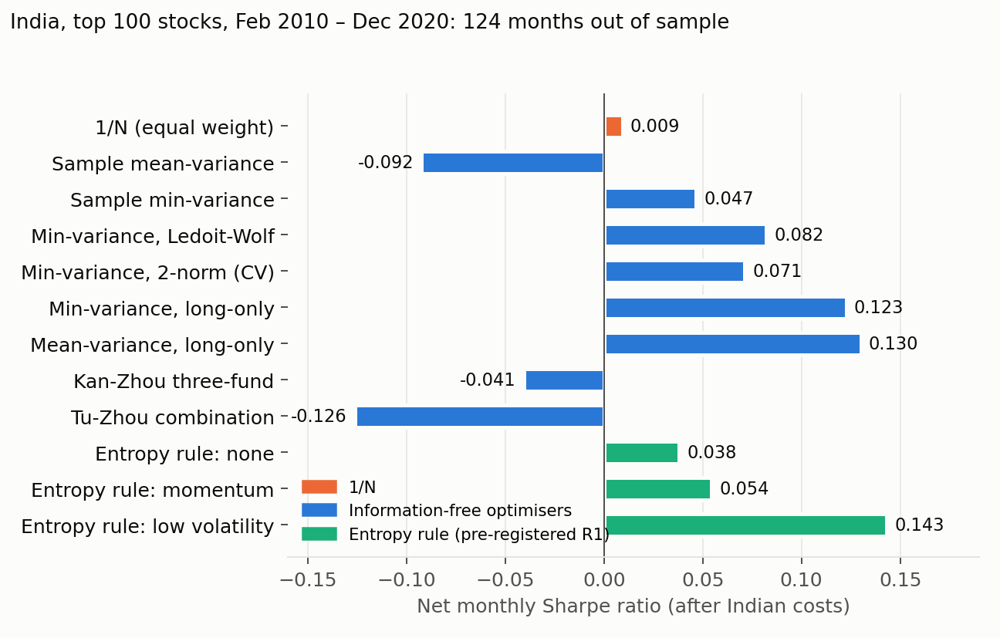
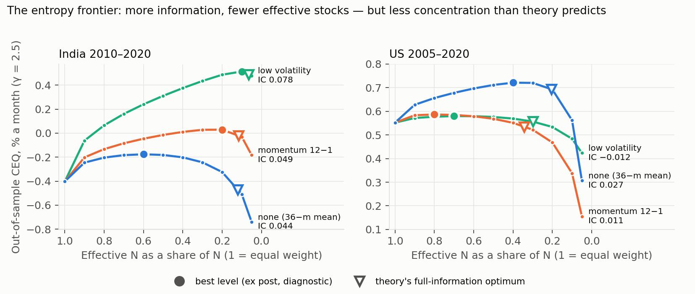

# Hold as much entropy as you have ignorance? Matching diversification to a signal's information

*Research proposal and first results. Mrigay Pathak (Finance and Informatics, Indiana
University). November 2026. Full record: `docs/entropy_portfolio/NOTE.md`; code and data
steps: `scripts/ep_*.py`.*

## The question

DeMiguel, Garlappi & Uppal (2009) showed that no mean–variance optimiser reliably beats
the equal-weight portfolio (1/N) out of sample. Estimation-risk theory explains why. A
plug-in investor must estimate N means from T months, and Kan & Zhou (2007) show the
optimal scaling of the plug-in portfolio is θ²/(θ² + N/T), which is tiny for 100 stocks.

The equal-weight portfolio is also the **maximum-entropy** portfolio. My question:
- does the right amount of entropy to give up depend on how much information an
  investor's signal really carries;
- can estimation-risk theory predict that amount as a **number**?

## The idea

A cross-sectional signal (momentum, low volatility, …) tilts 1/N along one direction, so
the investor has to estimate only **one** unknown: how much the tilt pays. That turns
Kan–Zhou's ignorance term N/T into 1/T. The knowledge share becomes t²/(1+t²), where t is
the t-statistic of the signal's information coefficient (IC). The fundamental law
(Grinold 1989; Qian & Hua 2004) links this to IC and breadth.

The long-only tilt with maximum entropy for a given signal exposure is the Gibbs family
wᵢ ∝ exp(βzᵢ) (Jaynes 1957). Maximising mean–variance utility along it, with an explicit
cost of concentration, gives a predicted optimal effective N for any (IC, N, T). Example:
about 40 of 100 stocks at IC 0.03.

Near 1/N the entropy penalty is the same thing as the DeMiguel, Garlappi, Nogales & Uppal
(2009) 2-norm constraint, because Σw² = ‖w − 1/N‖² + 1/N. So the contribution is the
*information-matching rule*, not the penalty.

## What I have done

All steps were pre-registered before any real data were touched.
1. **Replicated DGU** on Kenneth French data: 8 of 10 checks within tolerances set in
   advance; the misses are explained by data revisions.
2. **Simulated a market with known truth:**
   - the theory locates the optimal effective N within one step of a 10-step dial;
   - but the Kan–Zhou shrinkage is too cautious on the concave entropy dial;
   - about 300–1,000 months are needed for a significant win over 1/N.
3. **Tested on real data:** survivorship-free NSE data (top 100 stocks, 2010–2020) and
   the point-in-time S&P 500 (2005–2020), with three textbook signals, Indian statutory
   costs, multiple-testing control (Hansen SPA, PBO), and a holdout (2021–2025) run once.

**Figure 1. India: 1/N versus optimisation, net of costs.**
- Plug-in Markowitz on 100 stocks fails badly: turnover 1,426 times capital a month.
- Optimisers that ignore expected returns beat 1/N before costs, and lose much of that
  edge after costs.
- The pre-registered entropy rule with a low-volatility signal had the best net Sharpe
  ratio (0.143 a month, about 0.50 a year) and the best net certainty equivalent of all
  strategies. Its edge over 1/N is not statistically significant (p = 0.13).

**Figure 2. The entropy frontier.** Out-of-sample certainty-equivalent return along the
entropy dial, from equal weight (left) to concentrated (right), for each signal.
- Circles mark the best level, chosen *ex post*; this is a diagnostic, not a strategy.
  Triangles mark the theory's full-information optimum.
- **Across the six cases, more information meant fewer effective stocks** (Spearman
  −0.89, p = 0.019).
- **But in all six the best portfolio was less concentrated than theory predicts** (by
  0.28 of N on average, p = 0.031). The theory treats stock-specific risk as independent;
  sectors make concentration costlier.

## Main findings so far

- **What held:**
  - information sets the *direction* of the optimal departure from 1/N;
  - the pre-registered rule never did significantly worse than 1/N and beat every
    information-free optimiser.
- **What failed:**
  - the predicted *amount* is biased toward too much concentration;
  - a 36-month IC history cannot time a signal; in the holdout it pointed the wrong way;
  - no rule beat 1/N significantly after multiple-testing control. The simulation said
    this needs far more than 124–191 months.
- **What survived the 2021–2025 holdout:** the signals' information vanished, 1/N won,
  and shrinking by the knowledge share beat acting on the full estimate in 5 of 6 cases.
  The threshold half of the thesis ("with no information, go back to maximum entropy")
  is the robust part.

## Proposed next steps (a semester)

1. **Fix the theory's blind spot.** Replace independent residuals with a factor (sector)
   residual model in the concentration cost, and test whether that removes the
   over-concentration bias.
2. **Shrink covariances too.** In the holdout the unshrunk risk-reduction tilt (toward
   low volatility) lost money, and treating covariances as known was the costly
   assumption.
3. **Gain power.** Extend India back with BSE data, add more markets, and use
   cross-market pooling, since a significant result needs hundreds more months.

## The question for you

Which estimation-risk framing would you build the paper on?
- **(a) Frequentist:** the Kan–Zhou / Tu–Zhou expected-out-of-sample-utility approach used
  here, where the shrinkage is t²/(1+t²) of a plug-in estimate.
- **(b) Bayesian:** a Black–Litterman / Pástor-style approach, where the IC is a prior with
  posterior precision, and 1/N is the maximum-entropy prior.

Both give "hold 1/N when the signal carries no information". They differ in how they
treat a signal whose information changes over time, which is exactly where our
calibration test failed.
