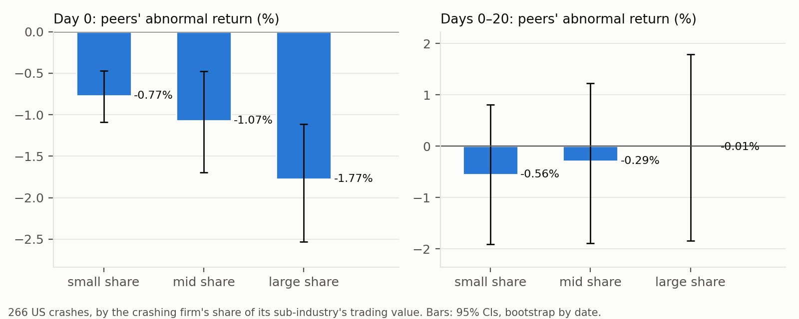
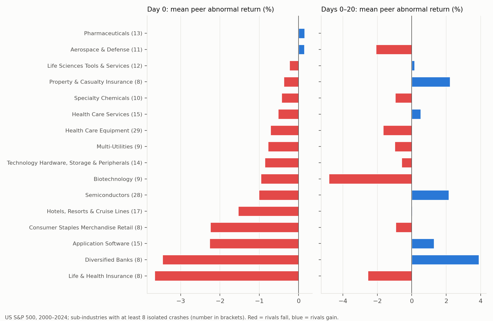
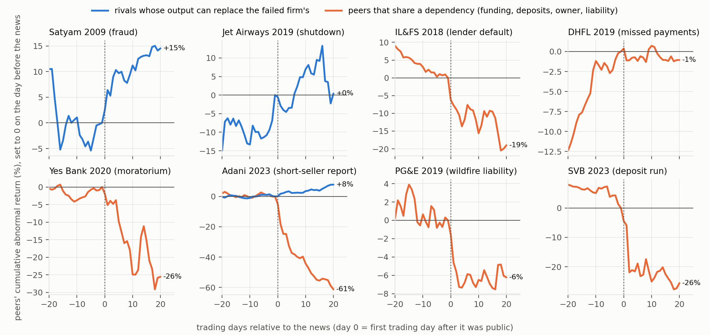
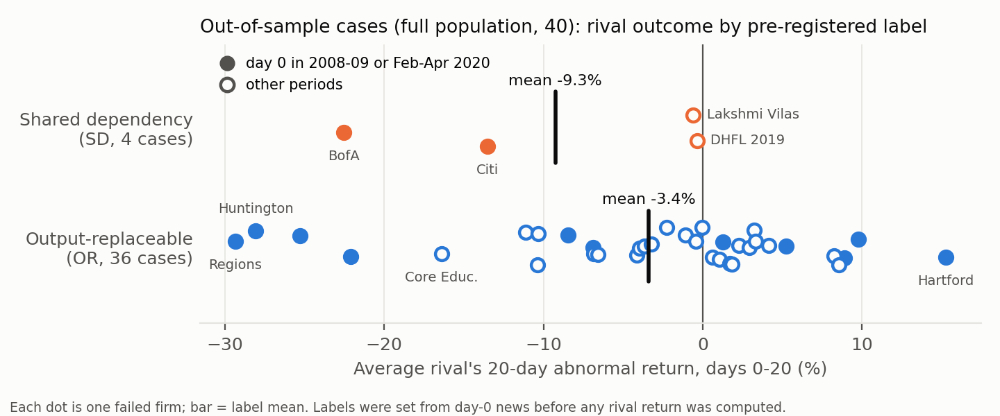

# Market Share Is Not Importance: What Happens to Rivals When a Firm Dies (US and India)

**Mrigay Pathak** · Indiana University Bloomington · Working paper draft, November 2026

*Pre-registration, code and data outputs: `docs/entropy_research/PREREGISTRATION.md`,
`scripts/death_test*.py`, `results/death_test/`, `results/death_test_oos/`. Every number
in this draft traces to a file listed in Appendix C.*

---

## Abstract

When a firm collapses, investors, lenders and regulators must judge on the day whether the
damage will spread to its rivals or be absorbed by them. The usual proxy is size: the
failed firm's market share, or its industry's concentration. We test that proxy, and an
alternative rule written down before the test. In 266 isolated crashes of S&P 500 firms
(2000–2024), rivals fall 1.2% against the market on the crash day, and more when the
failed firm is large. But the failed firm's share has no out-of-sample power to predict
the rivals' reaction (cross-validated R² below zero in every sample), while sub-industry
identity predicts 6–7% when the crash threshold is set at −10% or −20%. The alternative rule labels a collapse
**"shared dependency"** when, from the day-0 news alone, the rivals share the failed
firm's funding market, depositor base or legal liability. In a pre-registered test on 40
new US and Indian collapses, only 4 qualify. Over the next 20 trading days their rivals
lost 9.3% against the market, against 3.4% for the other 36 cases (difference −5.9
percentage points, permutation *p* = 0.15). The predicted sign was right in 50% of cases.
Under the pre-registered rules, the main hypothesis has **too few cases to test**, and the
prediction that rivals of "replaceable" firms hold up **fails**. Market share again does
not predict the reaction (*t* ≈ −1). The firm result is negative: market share is not a
measure of a firm's importance to its rivals. Shared dependency is a promising
replacement, but it is not established.

---

## 1. Introduction

On the morning a firm collapses (a fraud is confessed, a lender misses a payment, an
auditor resigns), many people must decide quickly whether the damage stays with that
firm. A portfolio manager holding its rivals must decide whether to sell them or buy more.
A lender to the rivals must decide whether to tighten terms. A regulator must decide
whether the failure is a local event or the start of a run. The quickest answer to hand
is size: a big firm with a large share of its market is assumed to matter more. Bank
regulation formalises this ("too big to fail"), and antitrust thinks in concentration
ratios.

This paper asks one narrow question: **when a firm suffers its own crash, do its rivals
gain or lose, and does its market share explain which?** The question goes back to Lang
and Stulz (1992), who found that rivals lose about 1% on average when a firm files for
bankruptcy, with competitive gains only in concentrated, low-leverage industries. We test
two answers to it.

The first is the size answer. In 266 isolated crashes of S&P 500 firms, rivals in the
same GICS sub-industry fall 1.2% against the market on the crash day, and 1.8% when the
failed firm is in the top third by share. Share therefore sizes the *first-day* hit. It
does not predict what follows. In a fair race, judged out of sample with five-fold
cross-validation, the failed firm's share and the industry's concentration have
*negative* predictive R² in every sample. Sub-industry identity alone predicts about 6–7%
of the variation when the crash threshold is −10% or −20%. Twenty days after the crash, the average rival
is within about 1 percentage point of where it started relative to the market (−0.3%,
95% interval −1.2% to +0.6%).

The second answer is the paper's own rule. A collapse spreads when the rivals **share a
critical dependency** with the failed firm (the same funding market, the same depositors,
the same owner, or a legal liability that applies to them too). It is absorbed when what
the firm produced can simply be supplied by others. Eight well-known collapses fit this
rule neatly. Satyam's IT rivals gained 12.6% in the month after its fraud. The Adani
group's own companies lost 42% after the Hindenburg report, while its sector rivals gained
8%. IL&FS's default dragged down nine NBFC and housing-finance lenders by 15%, the
wholesale-funded ones most. Those eight cases were
chosen after the fact, so the fit could be story-telling. We therefore **pre-registered**
a selection rule, a labelling rule and the tests. We committed them to a public
repository before computing any rival return, and labelled 40 new collapses from their
day-0 news alone.

The pre-registered test does not establish the rule. Applied strictly, the rule finds a
shared dependency in only 4 of 40 collapses. Citi's and Bank of America's rivals fell 13.5%
and 22.6% in late 2008 and early 2009, as predicted, but the two Indian cases barely moved.
With fewer than five such cases, the rule we fixed in advance says the main hypothesis
cannot be tested. The other half of the rule, that rivals of "output-replaceable" firms do
not lose, failed outright. Those rivals fell in 55% of cases, by 3.4% on average, and the
pre-registered reading of the split by financial and non-financial firms is "the rule
fails out of sample". Market share did not predict the out-of-sample reaction either.

The paper's claim is therefore narrower than the one we started with. **Market share does
not predict how rivals fare after a collapse. Industry identity predicts a little. A
dependency rule read from the news is promising, because the large shared-funding cases
behave as it says, but it is rare and not established, and its "replaceable rivals are
safe" half is wrong.** On average, rivals of a failed firm drift a little lower.

### Contribution

The question is old and the average answer ("rivals usually lose") is well known. What
this paper adds, relative to the four closest papers:

- **A direct, out-of-sample test of the failed firm's market share** (versus Lang and
  Stulz 1992). Lang and Stulz explain the sign of rival reactions by *industry*
  concentration and leverage. In our search we found no paper that regresses rival
  reactions on the *failed firm's own* share and compares it with industry identity out of
  sample. We find that share sizes the day-0 hit but has no out-of-sample predictive
  power, in either the large US sample or the pre-registered cases.
- **One ex-ante rule across finance and non-finance, tested by pre-registration** (versus
  Aharony and Swary 1983 and Jorion and Zhang 2007). Aharony and Swary show that bank
  failures caused by bank-specific problems such as fraud do not hit other banks. Jorion
  and Zhang show, using CDS spreads, that Chapter 11 filings bring contagion and Chapter 7
  liquidations a competitive effect. Both classify the *type* of event within one setting.
  We write a single rule (shared funding, depositors, owner or liability) and apply it to
  banks, insurers, lenders and non-financial firms alike. We fixed it in advance and
  labelled the cases blind to outcomes. In our search we found no pre-registered
  corporate-finance event study. The test also reports its own failure.
- **The horizontal version of input specificity, with Indian evidence** (versus Barrot and
  Sauvagnat 2016). Barrot and Sauvagnat show that a supplier's disaster hurts its
  customers only when the input is specific. That is a *vertical* dependency. We ask the
  *horizontal* question: do rivals gain when what the failed firm produced is replaceable?
  We add India, where business groups and short-term NBFC funding create shared
  dependencies that are rare in the US. Rival-level evidence for Satyam, IL&FS, DHFL and
  Yes Bank has, as far as we found, not been published. The horizontal answer is mostly
  no: replaceable output does not make rivals gain on average.

### Who can use this

**Investors and risk managers.** After a collapse, the question is which rivals to hedge
and which, if any, to buy. The evidence says three things. Do not size the hedge by the
failed firm's market share beyond the first day. Expect most rivals to share the day-0
fall (rivals fell on day 0 in about three of four cases) and much of it to persist, rather
than expecting replaceable rivals to gain. And treat a shared funding market as the
warning sign: the largest out-of-sample losses came where rivals were funded in the same
markets as a bank that needed a rescue.

**Regulators and competition authorities.** The policy question is "too big" versus "too
connected". Our evidence is against using share as the measure of how much a failure
spreads to rivals. It is consistent with, but does not prove, the view that what matters
is a shared dependency: a funding market, depositor confidence, a group owner or a
liability regime. For competition policy, the Satyam and Adani cases are reminders that
rivals can absorb even a large firm's collapse when its output is replaceable.

**Researchers.** The bank-contagion, supply-chain and business-group literatures each
study one kind of shared dependency. This paper offers one ex-ante rule that spans them,
a pre-registered protocol (rules, case list and code are public), and Indian cases. The
rule's failure on its "replaceable" half is itself informative: information spillovers
(Foster 1981) appear to dominate competitive gains for most collapses.

The rest of the paper sets out the framework (Section 2), the data (Section 3), the
large US sample (Section 4), the eight case studies (Section 5), the pre-registered test
(Section 6), robustness (Section 7), economic magnitude and implications (Section 8),
limitations (Section 9) and conclusions (Section 10).

---

## 2. Framework

**Concentration and replaceability.** Concentration measures how a market's sales are
split among firms. The Herfindahl–Hirschman index (HHI) and its information-theory cousin,
entropy, are the standard summaries: low entropy (high HHI) means a few firms dominate.
The motivating idea of this project is that a dominant, hard-to-copy business is valuable
because it is hard to replace. "Hard to replace", however, is not the same as "large".
A firm can have a large share of a market whose product others can supply tomorrow.
A small firm can be the one that everyone else depends on, for example the lender that
keeps a funding market open.

**The death test.** A collapse is a natural experiment in replaceability. If the failed
firm's output was replaceable, its customers move to rivals and the rivals should gain
(the competitive effect). If the rivals depended on something the failed firm also
depended on, or on the firm itself, the rivals should lose (contagion). The average
reaction mixes the two, which is why the literature finds small average losses (Lang and
Stulz 1992; Ferris, Jayaraman and Makhija 1997).

**The dependency hypothesis.** We classify a collapse by what the rivals share with the
failed firm:

- **(F) Funding:** the failed firm is a financial intermediary with a funding or solvency
  failure, and the rivals fund themselves in the same market (commercial paper, bonds,
  money-market funds, interbank loans, uninsured deposits);
- **(D) Depositors:** a deposit-taker faces withdrawals, a moratorium or a takeover, and
  the rivals take deposits too;
- **(L) Liability:** the trigger is a legal liability or regulatory finding whose legal
  basis applies to the rivals too;
- **(O) Owner:** the group's other listed firms (tested separately, through group sets).

A collapse with none of these is **output-replaceable (OR)**. The prediction is that rivals
lose after shared-dependency (SD) collapses and do not lose after OR collapses. Market
share should not matter once the label is known.

**Evidence on each channel.** Each dependency has its own literature. Bank runs spread
through depositor confidence (Diamond and Dybvig 1983). In India, a co-operative bank's run
spread through depositor networks (Iyer and Puri 2012), and banks with more interbank
exposure to a failed bank lost more deposits (Iyer and Peydró 2011). When financial firms
fail, information contagion hits rivals in the same lines of business (Helwege and Zhang
2016). A bankrupt firm's suppliers lose value, mostly where goods are specialised (Hertzel,
Li, Officer and Rodgers 2008). Indian NBFCs relied on short-term money from liquid debt
mutual funds, a shared funding market (Anshuman and Sharma 2020). Indian business groups
move resources between affiliates (Bertrand, Mehta and Mullainathan 2002), and intragroup
loans flow to weaker affiliates (Gopalan, Nanda and Seru 2007), so group firms are
financially linked. After the Hindenburg report on the Adani group, Indian firms with
pledged shares fell more (Ganguly, Mishra and Platt 2025). The rule in this paper puts
these channels under one test.

**Transmission or revelation?** A rival's price can fall because the failure damages it
(IL&FS froze the funding market that other lenders used) or because the failure *reveals*
that the rival has the same weakness (Silicon Valley Bank's collapse revealed the
uninsured-deposit and bond-loss exposure of other regional banks). Prices cannot
separate the two, and we do not try. Both mean that rivals lose, and neither depends on
the failed firm's share. The circularity worry ("rivals fall when the shock hits
something they share" is true by definition) is answered by design. The label is written
from the day-0 news, before rival returns are seen, so it can fail, and on half of its
prediction it does.

---

## 3. Data

**United States.** Daily prices for S&P 500 point-in-time members, 2000–2024, including
firms later delisted. We use raw closes with a $1 price floor, and drop one-day returns
above +100% or below −95%. Peer groups are GICS sub-industries from the current
classification file. This is a limitation: firms that left the index have no
sub-industry, and peers are today's members. Size is the 63-day average traded value,
lagged one day. The data contain no market capitalisations or revenues, so "share" means a
firm's share of its sub-industry's trading value.

**India.** The NSE bhavcopy survivorship-free panel, which includes delisted firms,
corrected for splits and bonuses, with adjusted Yahoo closes used where a stock has them.
The universe is the top 300 stocks by 63-day traded value, lagged one day. A data hole
from 22 June to 30 December 2011 is skipped.

**Abnormal returns.** In the large US sample (Section 4), the rival reaction is the
equal-weighted sub-industry peer return minus the market return excluding that
sub-industry, summed over the window (a cumulative abnormal return). In the case studies
and the pre-registered test, the outcome is each rival's 20-day buy-and-hold abnormal
return (BHAR) over days 0–20: its compounded return minus the compounded equal-weighted
market return, excluding the failed firm, its rivals and its group.

---

## 4. US evidence: 266 isolated crashes

**Events.** An event is a day on which an S&P 500 member falls more than 15% *and* at least
12 percentage points more than its sub-industry peers. It must be the only such firm in
its sub-industry that day, have at least 3 peers, and not reverse by more than 25% the next
day (a likely bad print). Each stock can have one event per 20 trading days. This gives
266 events in 37 sub-industries.

**Table 1. Rival reaction to an isolated crash, by the failed firm's share of its
sub-industry**

| Failed firm's share | Events | Rivals, day 0 | Rivals, days 0–20 | % of events where rivals fell on day 0 |
|---|---|---|---|---|
| All | 266 | **−1.20%** (clustered *t* −6.8) | −0.29% [95% CI −1.24, +0.62] | 71% |
| Small (bottom third) | 89 | −0.77% | −0.56% | 63% |
| Mid | 88 | −1.07% | −0.29% | 70% |
| Large (top third) | 89 | **−1.77%** | −0.01% | 81% |
| Large − small | | **−1.00 pp** [−1.79, −0.26] | +0.54 pp [−1.64, +2.70] | |

*Day 0 is the crash day. Confidence intervals come from a bootstrap that resamples event
dates; t-statistics are clustered by date. Source: `results/death_test/robustness.csv`,
`us_by_share_tercile.csv`.*

*Figure 1. Rivals' day-0 and 20-day reactions by the failed firm's share tercile, with
95% bootstrap intervals (266 US crashes).*

Rivals share the crash: on the crash day the average rival falls 1.2% against the market,
and rivals fall in 71% of events. Size matters on day 0: when the failed firm is in the top
third by share, rivals fall 1.8%, against 0.8% in the bottom third. Within a month the
average reaction is small: −0.3%, with an interval that rules out a large lasting loss or
gain. The share gap does not persist either. Over 20 days, rivals of the largest failed
firms do no worse than rivals of the smallest.

**Does share predict? A fair race.** In-sample R² flatters models with many dummies, so we
compare models by five-fold cross-validated R²: fit on 80% of events, predict the other
20%, and repeat. A negative value means the model predicts worse than the sample average.

**Table 2. What predicts the day-0 rival reaction? In-sample versus out-of-sample R²**

| Sample | Events | In-sample adj. R²: share + HHI | In-sample: sub-industry | **Out-of-sample R²: share + HHI** | **Out-of-sample: sub-industry** |
|---|---|---|---|---|---|
| Baseline (−15% crash) | 266 | 0.8% | 14.2% | **−0.6%** | −1.3% |
| Crash threshold −10% | 830 | 0.1% | 12.2% | **−0.5%** | **+7.2%** |
| Crash threshold −20% | 117 | 0.9% | 18.2% | **−3.0%** | **+6.1%** |
| Excluding Financials | 231 | 0.1% | 6.5% | **−1.5%** | −2.6% |

*Source: `results/death_test/robustness.csv` (columns `d0_adjR2_*`, `d0_cvR2_*`).*

In sample, sub-industry identity appears to explain about 14% of the day-0 reaction and
share plus HHI less than 1%. That contrast was this project's original headline ("industry
explains ten times more than share"), and **it was over-fitted**. Out of sample, in the
baseline sample, *neither* predicts. With other crash thresholds (−10%, 830 events; −20%,
117 events), sub-industry identity predicts 6–7% of the variation out of sample. Share and HHI never
predict anything. Within a sub-industry, the share coefficient on the day-0 reaction is
negative but not significant (clustered *t* = −1.8). The fair statement is that **industry
identity carries some out-of-sample information about how rivals react, and the failed
firm's market share carries none.**

*Figure 2. Mean rival abnormal return by sub-industry, on day 0 and over days 0–20
(sub-industries with at least 8 isolated crashes; number of events in brackets). Red =
rivals fall, blue = rivals gain.*

Industry patterns are fairly stable for the day-0 reaction. Ranking sub-industries by
their average day-0 reaction in 2000–12 and again in 2012–24 gives a Spearman correlation
of 0.79, but only 7 sub-industries have enough events in both halves. The 20-day reaction
is not stable.

---

## 5. Eight case studies

We studied eight well-known collapses in detail: six Indian, two American. Day 0 is the
first trading day after the news. Rivals are chosen by line of business, and returns are
20-day buy-and-hold against the market.

**Table 3. Eight collapses chosen after the fact**

| Case | Shock | Peer group | Rivals, 20-day BHAR | Rivals up | Reading |
|---|---|---|---|---|---|
| Satyam (2009) | Chairman confesses accounting fraud | 6 IT rivals | **+12.6%** (*t* 1.4) | 5 of 6 | Replaceable: rivals took its clients |
| Jet Airways (2019) | Airline grounded | IndiGo | −0.1% | 0 of 1 | Replaceable, and priced in before the event |
| Adani (2023) | Hindenburg short-seller report | 6 Adani-group firms | **−41.9%** (*t* −9.6) | 0 of 6 | Shared owner and funding |
| | | 5 sector rivals | **+7.7%** (*t* 2.0) | 5 of 5 | The businesses were replaceable |
| IL&FS (2018) | Unlisted lender defaults | 9 NBFC / housing-finance lenders | **−15.0%** (*t* −4.7) | 2 of 9 | Shared wholesale funding |
| DHFL (2019) | Misses bond payments | 8 lenders | −1.0% | 3 of 8 | Already priced; no further spread |
| Yes Bank (2020) | RBI moratorium | 9 private banks | **−19.7%** (*t* −6.8) | 1 of 9 | Shared depositor confidence (COVID overlaps) |
| PG&E (2019) | Wildfire-liability bankruptcy | Edison, Sempra | −6.7% | 0 of 2 | Shared liability regime |
| SVB (2023) | Deposit run | 9 regional banks | **−24.5%** (*t* −4.6) | 0 of 9 | Shared depositor confidence |

*t-statistics are for the cumulative abnormal return across rivals. Source:
`results/death_test/summary.json` (`part_b.cases`).*

*Figure 3. Cumulative abnormal return, days −20 to +20, of rivals whose output can replace
the failed firm's (blue) and of peers that share a dependency with it (orange).*

The pattern is striking. Where rivals shared funding, depositors, an owner or a liability
regime, they fell hard. Where the failed firm's output was replaceable, they held up or
gained. Size was not the driver: Satyam was India's fourth-largest IT firm, and its rivals
gained. But these cases were picked *because* they are famous, after we knew the outcomes,
so the labels could be fitted to the story. Section 6 is the test of whether the rule
works when that is impossible.

---

## 6. The pre-registered out-of-sample test

### 6.1 Design

The full protocol is in `PREREGISTRATION.md`. It was committed in two parts. The rules
(hypotheses, data, selection, labelling, outcomes, tests and verdict criteria) were
committed before the selection code ran. The case list, with each case's news paragraph,
label and rival set, was committed after Mrigay Pathak checked the labels and **before any
rival return was computed**. The git timestamps are the record.

**Selection.** A stock qualifies if its 20-day abnormal return falls below −50% (route 1),
or it stops trading after a 60-day abnormal fall of more than 30% and the news shows a
default, insolvency, suspension or forced delisting (route 2). Windows start from 2006
(India) or 2000 (US). We exclude the eight case-study episodes. After the exclusions, 106
Indian and 89 US candidates remained, and a random sample of 60 was drawn in each market
(seed 20261111). A news search then dropped data artefacts (splits, bonuses, demergers),
falls with no news to date them, industry-wide shocks, and cases with fewer than 3 rivals.
That left **26 cases: the registered sample**. Because only 2 of them were labelled shared
dependency, below the 5 the main test needs, we lifted the sample cap before computing any
returns (deviation D1) and news-checked every remaining candidate under the same rules.
That added 14 cases, for a **full population of 40**. Both versions are reported.

**Labels.** For each case we wrote one paragraph describing the shock as known on day 0,
with no information about rival prices or later events. The label follows from that
paragraph by the rule in Section 2, with ties going to OR. Rivals are the S&P 500 members
of the failed firm's sub-industry (US) or up to 10 hand-picked firms selling the same
product to the same customers (India). Group firms are excluded from rival sets and
tested separately.

**Tests.** The case outcome is the mean rival BHAR over days 0–20.

- *Prediction:* SD outcome < 0; OR outcome ≥ 0.
- *T1:* SD mean minus OR mean, with a one-sided permutation *p* (20,000 label shuffles).
- *T2:* the share of cases whose sign matches the prediction (the hit rate), with a Fisher
  exact test.
- *H1 verdict:* "supported" needs T1 *p* < 0.05 and a hit rate above 50% in both labels.
  "Too few cases to test" applies if either label has fewer than 5 cases.
- *T3:* the same tests within financial and non-financial failed firms, with the meaning
  of each outcome fixed in advance.
- *T4:* India's business-group sets.
- *T5:* the failed firm's share, as a Spearman correlation and an OLS of the outcome on an
  SD dummy and share.

### 6.2 What the rule found

The first result came before any return was computed. **Applied strictly, the rule labels
very few collapses as shared dependency: 2 of 26 in the registered sample, 4 of 40 in the
full population.** The four are Citigroup (19 November 2008), Bank of America (16 January
2009), Lakshmi Vilas Bank (30 September 2019) and DHFL (1 October 2019). Most firms that
collapse on their own news do so for reasons of their own: fraud, governance, auditor
resignations, their own losses, pledged-share sales by their promoters. Several borderline
cases went to OR under the tie-break: State Street and Regions in January 2009, Reliance
Capital and Indiabulls Housing in 2019, MBIA in 2007. The rule needs a funding or solvency
failure as the trigger, and the day-0 news showed large losses and capital worries
without one.

### 6.3 Results

**Table 4. Pre-registered tests (PREREGISTRATION §7)**

| | Registered sample (primary) | Full population (D1) |
|---|---|---|
| Cases (SD / OR) | 26 (2 / 24) | 40 (4 / 36) |
| Mean rival BHAR, SD cases | **−18.0%** | **−9.3%** |
| Mean rival BHAR, OR cases (median) | **−3.7%** (−0.8%) | **−3.4%** (−0.8%) |
| T1: SD − OR | −14.3 pp (description only) | −5.9 pp, perm. *p* = 0.152 (description only) |
| T2: hit rate, all | 13/26 = 50% | 20/40 = 50% |
| T2: hit rate, SD / OR | 2/2 / 11/24 = 46% | 4/4 / 16/36 = 44% |
| T2: Fisher exact *p* | not computed | 0.116 |
| **H1 verdict** | **Too few cases to test** | **Too few cases to test** |
| T3: financial (SD/OR cases; OR hit) | 2/9; 44% | 4/14; 43% (SD − OR −3.1 pp, *p* 0.35) |
| T3: non-financial (SD/OR; OR hit) | 0/15; 47% | 0/22; 45% |
| **T3 pre-registered meaning** | **"The rule fails out of sample"** | **Same** |
| T4: group sets (India) | 3 sets, all negative, mean −28.0%, sign *p* 0.125 | same 3 sets |
| T5: SD dummy (*t*) | −13.2 pp (−2.96) | −6.3 pp (−1.42) |
| T5: share coefficient (*t*) | −0.15 (−0.99) | −0.14 (−1.01) |
| T5: Spearman (share, outcome) | −0.14 (*p* 0.51) | −0.09 (*p* 0.58) |

*Outcome = mean rival BHAR over days 0–20. "Description only": §7 forbids a verdict with
fewer than 5 cases in a label, and no p is computed with fewer than 3. Source:
`results/death_test_oos/tests.json`.*

*Figure 4. Each dot is one of the 40 out-of-sample collapses: the average rival's 20-day
abnormal return, by pre-registered label. Filled dots have day 0 in 2008–09 or
February–April 2020.*

**H1: too few cases to test.** In both versions fewer than 5 collapses are SD, so the
verdict we fixed in advance is that H1 cannot be tested. For description: the four SD
cases have rivals 5.9 pp worse than the OR cases (*p* = 0.15). The gap comes from the two
US bank rescues. Citi's rivals lost 13.5% and Bank of America's 22.6%, while Lakshmi Vilas's
lost 0.6% and DHFL's 0.4%. For DHFL in October 2019 the median rival rose and only 4 of
10 fell, consistent with the case-study reading that DHFL's stress was already priced.

**The OR half fails.** The rule predicts that rivals of replaceable firms do not lose.
They did lose in 20 of 36 cases, with a mean of −3.4% and a median of −0.8%. Under the
pre-registered T3 reading, the rule works neither inside finance (OR hit rate 43%, below
the 50% required) nor outside it (45%, below the 2/3 required when there are no SD cases).
So **the rule fails out of sample** by its own criteria. The failure is not concentrated in
one kind of firm. Non-financial OR rivals averaged −1.6% and financial OR rivals −6.2%.
The negative drift is real enough to defeat a sign prediction, but small: the 95% interval
for the OR mean is −6.8% to 0.0% (descriptive, not a pre-registered test).

**Business groups (H3).** All three Indian group sets fell: the Anil Ambani group firms
after Reliance Communications' insolvency filing (−37.5%), the same group after Reliance
Capital's auditor resigned (−9.9%), and the Indiabulls group after the fraud petition
against Indiabulls Housing (−36.5%). With three sets, a sign test cannot do better than
*p* = 0.125, so this is consistent with the owner channel, not evidence for it.

**Market share (H4).** Share does not predict the rival reaction in either version.
The coefficient is about −0.15 (a failed firm with 30% rather than 10% of its rival group's
trading goes with rivals about 3 pp worse), with *t* ≈ −1. The Spearman correlation is
−0.1. In the registered sample, the regression meets the full T5 prediction (SD
coefficient *t* = −2.96, share *t* = −0.99), but the SD dummy there rests on two cases. In
the full population the SD coefficient is no longer significant (*t* = −1.42).

**Day 0.** On the collapse day, rivals fell in about three of every four OR cases (OR mean
−2.0%), as in the large sample. The first-day spillover does not depend on the label.

---

## 7. Robustness

**Large US sample.** Table 5 repeats the Part A event study under alternative choices.

**Table 5. Robustness of the large-sample result**

| Variant | Events | Day 0 (clustered *t*) | Days 0–20 [95% CI] | Large − small share, day 0 [CI] |
|---|---|---|---|---|
| Baseline (sub-industry, −15%) | 266 | −1.20% (−6.8) | −0.29% [−1.24, +0.62] | −1.00 pp [−1.79, −0.26] |
| Crash threshold −10% | 830 | −0.72% (−7.1) | −0.49% [−1.01, +0.01] | −0.62 pp [−0.97, −0.28] |
| Crash threshold −20% | 117 | −1.65% (−7.4) | −0.87% [−2.48, +0.81] | −1.03 pp [−1.87, −0.13] |
| Excluding 2008–09 and 2020 | 199 | −1.20% (−9.2) | −0.73% [−1.60, +0.12] | −0.92 pp [−1.57, −0.29] |
| Excluding Financials | 231 | −0.90% (−6.4) | −0.50% [−1.32, +0.28] | −0.69 pp [−1.26, −0.11] |
| Sector-level peers | 513 | −0.50% (−7.1) | −0.22% [−0.67, +0.23] | −0.15 pp [−0.51, +0.18] |

*Source: `results/death_test/robustness.csv`.*

The day-0 spillover survives every variant, including the exclusion of all financial firms
(−0.90%), so it is not only a banking story. The 20-day effect is small, but not provably
zero. The larger −10% sample gives −0.49% with an interval that only just includes zero,
which hints at a small lasting drag. That matches the out-of-sample OR drift. Wider peer
groups (whole sectors) dilute the effect, and the share gap disappears.

**Pre-registered checks (PREREGISTRATION §8).**

**Table 6. Pre-registered robustness checks, full population (registered sample in
brackets)**

| Check | SD mean | OR mean | OR hit rate | SD − OR, perm. *p* |
|---|---|---|---|---|
| Market-model (beta-adjusted) BHAR | −9.7% [−17.9%] | −2.8% [−3.2%] | 44% [46%] | 0.097 |
| Median rival instead of mean | −10.0% [−20.2%] | −3.6% [−4.1%] | 33% [33%] | 0.124 |
| Day 0 only | −3.2% [−5.6%] | −2.0% [−1.8%] | 22% [25%] | 0.210 |
| Days 0–5 | −4.6% [−7.0%] | −1.5% [−1.0%] | 44% [50%] | 0.140 |
| Excluding 2008–09 and Feb–Apr 2020 | **−0.5%** (2 cases) [none] | −1.7% [−1.9%] | 44% [47%] | not computed |
| US only | −18.0% [−18.0%] | −5.0% [−4.5%] | 44% [50%] | not computed |
| India only | **−0.5%** (2 cases) [none] | −1.8% [−2.9%] | 44% [42%] | not computed |

*Source: `results/death_test_oos/tests.json` (`robustness`). The industry-shock cases,
described separately as pre-registered, average −9.0% (8 cases, most in March 2020).*

Two findings matter. First, **outside the 2008–09 and 2020 crisis months, and in India
alone, SD rivals did slightly better than OR rivals**, the opposite of H1. The SD effect in
this sample is the 2008–09 US bank crisis. Second, beta-adjusting the returns gives the
largest gap (−6.9 pp, *p* = 0.097), still short of significance.

**A check that was not pre-registered.** Some cases overlap. Regions, Fifth Third and
Huntington reported within two days of each other in January 2009 and are each other's
rivals, so one rival move is counted up to three times. Indiabulls Housing and DHFL (16
trading days apart) are each other's rivals too. Dropping the later case of each such
pair (Fifth Third, Huntington, DHFL 2019) leaves 37 cases (3 SD). The full-population gap
widens to −10.2 pp (*p* = 0.050), and the OR hit rate is 47%. The verdicts do not change:
SD is still below 5 cases, and the T3 reading is still "fails". We chose this check after
seeing the data (we promised it in the case list before seeing outcomes, but did not fix
it in the rules). It rests on three SD cases, two of them Citi and Bank of America, so we
do not count it as support. (Source: `results/death_test_oos/sensitivity_overlap.json`.)

**A pre-registered filter that removed real returns.** To catch unadjusted corporate
actions, the rules drop rival daily returns beyond ±45%. In 2008–09 this removed some real
moves: Fifth Third's +60% and Regions' +48% on 6 February 2009 fall inside three OR cases'
windows (`results/death_test_oos/run.log`). Removing them makes those OR outcomes more
negative, which works against the OR prediction. We left the rule as written.

---

## 8. Economic magnitude and implications

**What an investor would have seen.** Take an investor holding an equal-weighted basket of
a failed firm's rivals, worth $10 million on the day of the collapse. Over the next month,
relative to the market:

- after the 4 shared-dependency collapses, the basket lost on average about **$0.93
  million** (−9.3%); after Citi and Bank of America alone, about $1.8 million (−18.0%);
- after the 36 output-replaceable collapses, the basket lost on average about **$0.34
  million** (−3.4%), with the median case losing about $0.08 million (−0.8%);
- most of the OR loss arrives on day 0 (−2.0%);
- outside the 2008–09 and 2020 crises, the two kinds of collapse cost the investor about
  the same (−0.5% and −1.7%).

These are descriptions of the pre-registered numbers, not a trading strategy. No new
test is involved. The magnitudes say that the shared-dependency label, when it applies,
flagged the largest losses in this sample, but those were two bank rescues in one crisis.
The "replaceable" label did not flag safety: the typical rival lost a little.

**For portfolios.** The project began from the intuition that one should own hard-to-replace
("low-entropy") businesses in a well-diversified ("high-entropy") portfolio. The diversified
half is supported (Appendix A): random S&P 500 portfolios with more stocks have a better
*typical* outcome, because single-stock returns are skewed (Bessembinder 2018). The death
test says something narrower about the hard-to-replace half. A firm's market share is not
a good measure of how much the market depends on it, and when a firm fails, its rivals
should be expected to share the first-day fall rather than to gain.

---

## 9. Limitations

- **Too few shared-dependency cases.** A rule applied strictly from day-0 news finds 4 of
  40. A real test of H1 needs perhaps 20–30 such cases. That means a larger, longer sample
  (CRSP from 1926, more emerging markets) or a design targeted at financial distress.
- **Crisis clustering.** 11 of the 20 US out-of-sample cases fall between September 2008
  and March 2009, when bank stocks fell together for reasons broader than any one failure. The
  rule calls a single firm's crash firm-specific even when its whole sector is under stress.
- **Peer groups.** US peers come from the *current* GICS file, so they are survivors, and
  many 2000s collapses were dropped for having fewer than 3 such peers. Indian rivals were
  picked by hand (before outcomes were known, but by one team). Text-based peers (Hoberg
  and Phillips 2016) or historical CRSP/Compustat codes would be better.
- **The share proxy.** Share is trading value among index members, not revenue share. A
  noisy measure biases its coefficient toward zero. Revenue shares from Compustat are the
  fix. In the meantime the right claim is "this share proxy has no predictive power", not
  "true market share never matters".
- **Transmission versus revelation.** Prices cannot distinguish a failure that damages
  rivals from one that reveals their shared weakness. We do not try.
- **One labeller.** The paragraphs and labels were written by one research team (an AI
  assistant drafted them; the author approved them). An independent labeller, or an LLM
  given the same rule (planned), would test the labels' reliability.
- **A filter fixed in advance removed some real returns** (Section 7).
- **Overlapping cases** count some rival moves more than once. The sensitivity check in
  Section 7 handles this, but it was not pre-registered.

---

## 10. Conclusion

We asked whether a failed firm's market share explains whether its rivals gain or lose.
It does not. In a large US sample, share sizes the first-day spillover but has no
out-of-sample power to predict the reaction, while industry identity predicts a little.
In a pre-registered test on 40 new collapses, share again predicts nothing. The paper's
alternative, a shared-dependency rule read from the news, behaved as predicted in the
large bank rescues of 2008–09, where rivals lost 13–23% in a month. But it applied to too
few collapses to be tested, it did not work outside the 2008–09 crisis, and its claim that
rivals of replaceable firms hold up failed. The honest summary is that **market share is
not importance**, and that **what rivals share with a failed firm is the most promising
candidate to replace it, but it is not yet established.** A pre-registered test with more
shared-dependency cases is the obvious next step. We have published the protocol so that
others can run it.

---

## Appendix A. Portfolio and market entropy (Tests 1–2)

*Source: `results/entropy_research/` (script `scripts/entropy_research.py`). Data: S&P 500
point-in-time members, 2000–2024.*

**Test 1: does a high-entropy (diversified) portfolio do better?** In five 5-year windows,
we drew 5,000 random equal-weighted portfolios of N stocks from that date's index members
and compared each with holding all members.

| N stocks | Median return / yr | Chance of lagging all-members by > 3 pp/yr | Worst 5% |
|---|---|---|---|
| 1 | 9.8% | 46% | −13.4% |
| 10 | 11.1% | 25% | +5.0% |
| 50 | 11.6% | 5% | +8.8% |
| All (~390) | 11.7% | — | — |

Diversification does not raise expected wealth (by construction, a random pick has the
same expected value at every N). It raises the *typical* outcome and removes the left
tail, because only 39–47% of stocks beat the all-members portfolio in each window
(Bessembinder 2018). A buy-and-hold equal-weighted portfolio also concentrates by itself:
its effective number of stocks falls 17–40% over 5 years.

**Test 2: is a low-entropy (highly co-moving) market more fragile?** Low co-movement
entropy (stocks moving together) appears *during* crises, and rebounds follow. After
controlling for current volatility, *higher* entropy goes with deeper future drawdowns
(US *t* = −2.1). India shows the same sign, but it is not significant. The simple claim
"low entropy = fragile" fails. Risk seems to build in calm periods (Brunnermeier and
Sannikov 2014).

---

## Appendix B. The 40 out-of-sample cases and 8 industry shocks

*Labels were fixed from day-0 news before returns were computed (PREREGISTRATION §9). "reg."
= registered sample; "ext." = D1 extension. Day-0 AR = mean rival abnormal return on day
0. Share = failed firm's share of its rival group's traded value. Source:
`results/death_test_oos/outcomes.csv` (rival sets).*

| # | Case | Day 0 | Sample | Fin. | Label | Rivals | Day-0 rival AR | 20-day rival BHAR | Share |
|---|---|---|---|---|---|---|---|---|---|
| 1 | IN-MAYTAS | 2008-12-17 | reg. | N | OR | 8 | −2.8% | −8.5% | 0.00 |
| 2 | IN-THINKSOFT | 2010-02-16 | reg. | N | OR | 10 | −0.3% | +1.0% | 0.18 |
| 3 | IN-COREEDU | 2013-02-25 | reg. | N | OR | 3 | −3.1% | −16.4% | 0.18 |
| 4 | IN-SUDAR | 2013-02-25 | reg. | N | OR | 5 | −1.6% | −4.1% | 0.07 |
| 5 | IN-DRDATSONS | 2013-02-25 | reg. | N | OR | 10 | +1.4% | +8.2% | 0.01 |
| 6 | IN-GITANJALI18 | 2018-02-14 | reg. | N | OR | 3 | −0.3% | +2.9% | 0.05 |
| 7 | IN-RCOM | 2019-02-04 | reg. | N | OR | 3 | −0.6% | +3.2% | 0.25 |
| 8 | IN-RELCAP | 2019-06-12 | reg. | Y | OR | 10 | −1.0% | −1.1% | 0.10 |
| 9 | IN-CGPOWER | 2019-08-20 | reg. | N | OR | 3 | −0.1% | −0.5% | 0.08 |
| 10 | IN-IBHFL | 2019-09-06 | reg. | Y | OR | 7 | −0.4% | −11.1% | 0.53 |
| 11 | IN-FRETAIL | 2020-03-06 | reg. | N | OR | 3 | +2.9% | +1.3% | 0.10 |
| 12 | IN-OMAXE | 2020-06-29 | reg. | N | OR | 4 | −1.9% | −10.3% | 0.06 |
| 13 | US-XRX | 2000-10-03 | reg. | N | OR | 3 | −1.9% | −3.2% | 0.05 |
| 14 | US-XEL | 2002-07-26 | reg. | N | OR | 11 | −2.3% | +4.1% | 0.11 |
| 15 | US-C | 2008-11-19 | reg. | Y | SD | 6 | −3.3% | −13.5% | 0.22 |
| 16 | US-HIG | 2008-10-30 | reg. | Y | OR | 4 | −2.2% | +15.3% | 0.27 |
| 17 | US-CI | 2008-10-30 | reg. | Y | OR | 4 | +2.0% | +8.9% | 0.17 |
| 18 | US-BAC | 2009-01-16 | reg. | Y | SD | 6 | −7.9% | −22.6% | 0.25 |
| 19 | US-STT | 2009-01-20 | reg. | Y | OR | 5 | −5.2% | +5.2% | 0.34 |
| 20 | US-RF | 2009-01-20 | reg. | Y | OR | 4 | −7.9% | −29.3% | 0.24 |
| 21 | US-FITB | 2009-01-22 | reg. | Y | OR | 4 | −9.0% | −25.3% | 0.23 |
| 22 | US-AFL | 2009-01-22 | reg. | Y | OR | 4 | −7.4% | −22.1% | 0.23 |
| 23 | US-TXT | 2009-01-29 | reg. | N | OR | 7 | +0.8% | −6.9% | 0.03 |
| 24 | US-EPAM | 2022-02-24 | reg. | N | OR | 4 | +0.2% | +0.6% | 0.20 |
| 25 | US-GL | 2024-04-11 | reg. | Y | OR | 4 | −2.0% | +2.3% | 0.13 |
| 26 | US-SMCI | 2024-10-30 | reg. | N | OR | 7 | +0.1% | −4.0% | 0.21 |
| 27 | US-PCG01 | 2001-01-04 | reg. | N | industry shock | 11 | −5.7% | −6.6% | 0.18 |
| 28 | US-TLAB01 | 2001-06-20 | reg. | N | industry shock | 3 | +0.3% | +12.4% | 0.09 |
| 29 | US-GNW08 | 2008-09-29 | reg. | Y | industry shock | 5 | −3.6% | −17.0% | 0.12 |
| 30 | IN-GITANJALI13 | 2013-06-24 | reg. | N | industry shock | 3 | −3.1% | −2.6% | 0.26 |
| 31 | IN-ATLANTA | 2007-02-23 | ext. | N | OR | 7 | −1.0% | −3.6% | 0.09 |
| 32 | IN-WOCKHARDT | 2014-05-27 | ext. | N | OR | 10 | +1.3% | +3.3% | 0.11 |
| 33 | IN-AMTEK | 2015-08-19 | ext. | N | OR | 3 | −0.2% | −6.6% | 0.16 |
| 34 | IN-RPOWER | 2019-02-04 | ext. | N | OR | 6 | −1.5% | +1.7% | 0.07 |
| 35 | IN-RELINFRA | 2019-02-04 | ext. | N | OR | 10 | −1.4% | −0.0% | 0.18 |
| 36 | IN-LVB | 2019-09-30 | ext. | Y | SD | 10 | −3.2% | −0.6% | 0.00 |
| 37 | IN-DHFL19 | 2019-10-01 | ext. | Y | SD | 10 | +1.5% | −0.4% | 0.05 |
| 38 | IN-ATGL | 2023-01-25 | ext. | N | OR | 3 | +0.2% | +8.5% | 0.43 |
| 39 | US-CI02 | 2002-10-25 | ext. | Y | OR | 4 | −3.0% | −10.4% | 0.30 |
| 40 | US-UNM03 | 2003-03-10 | ext. | Y | OR | 5 | −1.2% | −2.2% | 0.08 |
| 41 | US-MBI07 | 2007-12-20 | ext. | Y | OR | 5 | −1.1% | +1.8% | 0.22 |
| 42 | US-LNC08 | 2008-11-17 | ext. | Y | OR | 5 | −9.9% | +9.8% | 0.09 |
| 43 | US-HBAN09 | 2009-01-22 | ext. | Y | OR | 4 | −8.5% | −28.1% | 0.12 |
| 44 | US-PSKY21 | 2021-03-26 | ext. | N | OR | 3 | −1.7% | −6.8% | 0.19 |
| 45 | IN-CREDITACC20 | 2020-03-24 | ext. | Y | industry shock | 3 | −7.2% | −17.0% | 0.04 |
| 46 | IN-ABFRL20 | 2020-03-24 | ext. | N | industry shock | 5 | −3.2% | −14.1% | 0.05 |
| 47 | US-NCLH20 | 2020-03-12 | ext. | N | industry shock | 6 | −6.5% | −19.7% | 0.05 |
| 48 | US-APA20 | 2020-03-09 | ext. | N | industry shock | 5 | −26.3% | −7.9% | 0.10 |

---

## Appendix C. Traceability: where each headline number comes from

Run `~/.venvs/strategyhub/bin/python scripts/death_test_paper_check.py` to recompute every
number below from the files and check it against the text (it prints PASS/FAIL per row).

| Headline number | Value | Source |
|---|---|---|
| US isolated crash events | 266 | `results/death_test/us_events.csv` |
| Sub-industries in Part A | 37 | `results/death_test/us_events.csv` |
| Day-0 rival reaction, all | −1.20% | `results/death_test/robustness.csv (baseline d0_mean)` |
| Day-0 clustered t | −6.8 | `results/death_test/robustness.csv (d0_t_cl)` |
| Share of events with rivals down on day 0 | 71% | `results/death_test/robustness.csv` |
| 20-day rival reaction, all | −0.29% | `results/death_test/robustness.csv (0_20_mean)` |
| 20-day CI low / high | [−1.24, +0.62] | `results/death_test/robustness.csv` |
| Day 0, small / mid / large share | −0.77% / −1.07% / −1.77% | `results/death_test/us_by_share_tercile.csv` |
| Large − small share gap, day 0 [CI] | −1.00 pp [−1.79, −0.26] | `results/death_test/robustness.csv` |
| CV R², share + HHI (base, −10%, −20%, ex-Fin) | −0.6%, −0.5%, −3.0%, −1.5% | `results/death_test/robustness.csv (d0_cvR2_share_hhi)` |
| CV R², sub-industry (base, −10%, −20%, ex-Fin) | −1.3%, +7.2%, +6.1%, −2.6% | `results/death_test/robustness.csv (d0_cvR2_subind)` |
| In-sample adj. R², share + HHI / sub-industry (base) | 0.8% / 14.2% | `results/death_test/robustness.csv` |
| Within-sub-industry share t, day 0 | −1.8 | `results/death_test/robustness.csv` |
| Day 0 excluding Financials | −0.90% | `results/death_test/robustness.csv` |
| Persistence of day-0 reaction (Spearman, 7 sub-industries) | 0.79 | `results/death_test/summary.json` |
| Satyam rivals, 20-day BHAR | +12.6% | `results/death_test/summary.json` |
| Adani group firms, 20-day BHAR | −41.9% | `results/death_test/summary.json` |
| Adani sector rivals, 20-day BHAR | +7.7% | `results/death_test/summary.json` |
| IL&FS lenders, 20-day BHAR | −15.0% | `results/death_test/summary.json` |
| Yes Bank rivals, 20-day BHAR | −19.7% | `results/death_test/summary.json` |
| SVB regional banks, 20-day BHAR | −24.5% | `results/death_test/summary.json` |
| OOS SD mean, registered / full | −18.0% / −9.3% | `results/death_test_oos/tests.json` |
| OOS OR mean, registered / full | −3.7% / −3.4% | `results/death_test_oos/tests.json` |
| OOS SD − OR, registered | −14.3 pp | `results/death_test_oos/tests.json (mean_SD − mean_OR)` |
| OOS SD − OR, full | −5.9 pp | `results/death_test_oos/tests.json (full_population.T1_T2.diff)` |
| OOS permutation p, full | 0.152 | `results/death_test_oos/tests.json` |
| OOS Fisher p, full | 0.116 | `results/death_test_oos/tests.json` |
| OOS hit rate, all (both versions) | 50% / 50% | `results/death_test_oos/tests.json` |
| OOS OR hit rate, registered / full | 46% / 44% | `results/death_test_oos/tests.json` |
| H1 verdict (both) | too few cases to test / too few cases to test | `results/death_test_oos/tests.json` |
| T3 meaning (both) | rule fails out of sample / rule fails out of sample | `results/death_test_oos/tests.json` |
| T4 group sets mean, sign p | −28.0%, 0.125 | `results/death_test_oos/tests.json` |
| T5 SD t, registered / full | −2.96 / −1.42 | `results/death_test_oos/tests.json` |
| T5 share t, registered / full | −0.99 / −1.01 | `results/death_test_oos/tests.json` |
| Market-model perm p, full | 0.097 | `results/death_test_oos/tests.json` |
| Ex-crisis SD / OR mean, full | −0.5% / −1.7% | `results/death_test_oos/tests.json` |
| OR day-0 mean, full | −2.0% | `results/death_test_oos/outcomes.csv` |
| OR median, full | −0.8% | `results/death_test_oos/outcomes.csv` |
| Not pre-registered: overlap check SD − OR, p (full) | −10.2 pp, 0.050 | `results/death_test_oos/sensitivity_overlap.json` |
| $10m rival basket: SD / OR loss | $0.93 million / $0.34 million | `results/death_test_oos/tests.json` |
| Test 1 median return, N = 1 / 50 | 9.8% / 11.6% | `results/entropy_research/test1_summary_by_N.csv` |
| Test 1 chance of lagging by >3 pp, N = 1 / 50 | 46% / 5% | `results/entropy_research/test1_summary_by_N.csv` |

---

## References

- Aharony, J. and I. Swary (1983). Contagion effects of bank failures: Evidence from
  capital markets. *Journal of Business* 56(3), 305–322.
- Anshuman, V. R. and R. Sharma (2020). Financial fragility in retail-NBFCs. IIM Bangalore
  Working Paper No. 604.
- Barrot, J.-N. and J. Sauvagnat (2016). Input specificity and the propagation of
  idiosyncratic shocks in production networks. *Quarterly Journal of Economics* 131(3),
  1543–1592.
- Bertrand, M., P. Mehta and S. Mullainathan (2002). Ferreting out tunneling: An
  application to Indian business groups. *Quarterly Journal of Economics* 117(1), 121–148.
- Bessembinder, H. (2018). Do stocks outperform Treasury bills? *Journal of Financial
  Economics* 129(3), 440–457.
- Brunnermeier, M. K. and Y. Sannikov (2014). A macroeconomic model with a financial
  sector. *American Economic Review* 104(2), 379–421.
- Diamond, D. W. and P. H. Dybvig (1983). Bank runs, deposit insurance, and liquidity.
  *Journal of Political Economy* 91(3), 401–419.
- Ferris, S. P., N. Jayaraman and A. K. Makhija (1997). The response of competitors to
  announcements of bankruptcy: An empirical examination of contagion and competitive
  effects. *Journal of Corporate Finance* 3(4), 367–395.
- Foster, G. (1981). Intra-industry information transfers associated with earnings
  releases. *Journal of Accounting and Economics* 3(3), 201–232.
- Ganguly, S., S. Mishra and H. Platt (2025). [Adani–Hindenburg spillovers to Indian
  firms.] *Applied Economics Letters*. (Full title and pages to be added from the journal
  page before circulation.)
- Gopalan, R., V. Nanda and A. Seru (2007). Affiliated firms and financial support:
  Evidence from Indian business groups. *Journal of Financial Economics* 86(3), 759–795.
- Helwege, J. and G. Zhang (2016). Financial firm bankruptcy and contagion. *Review of
  Finance* 20(4), 1321–1362.
- Hertzel, M. G., Z. Li, M. S. Officer and K. J. Rodgers (2008). Inter-firm linkages and
  the wealth effects of financial distress along the supply chain. *Journal of Financial
  Economics* 87(2), 374–387.
- Hoberg, G. and G. Phillips (2016). Text-based network industries and endogenous product
  differentiation. *Journal of Political Economy* 124(5), 1423–1465.
- Iyer, R. and J.-L. Peydró (2011). Interbank contagion at work: Evidence from a natural
  experiment. *Review of Financial Studies* 24(4), 1337–1377.
- Iyer, R. and M. Puri (2012). Understanding bank runs: The importance of
  depositor-bank relationships and networks. *American Economic Review* 102(4), 1414–1445.
- Jorion, P. and G. Zhang (2007). Good and bad credit contagion: Evidence from credit
  default swaps. *Journal of Financial Economics* 84(3), 860–883.
- Lang, L. H. P. and R. M. Stulz (1992). Contagion and competitive intra-industry effects
  of bankruptcy announcements: An empirical analysis. *Journal of Financial Economics*
  32(1), 45–60.
