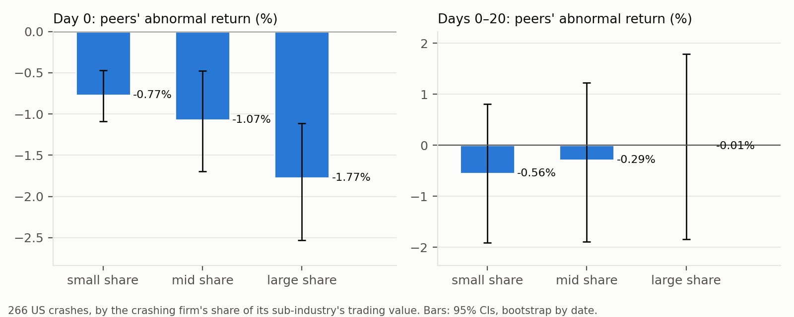
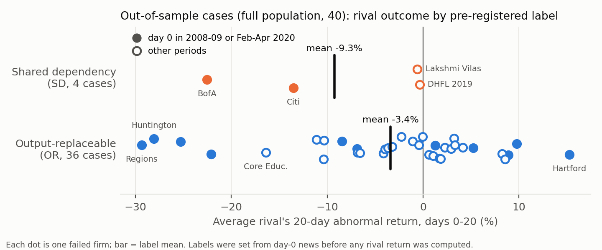

# Market Share Is Not Importance: What Happens to Rivals When a Firm Dies (US and India)

**Mrigay Pathak** · Indiana University Bloomington · Working paper draft, November 2026

*Short version for circulation. The full draft (`PAPER_DRAFT.md` / `.docx` in
`docs/entropy_research/`) is the online appendix: it has the 40-case table, the
traceability table mapping every number to its file in `results/`, and more detail.
Pre-registration: `docs/entropy_research/PREREGISTRATION.md`.*

## Abstract

When a firm collapses, investors, lenders and regulators must judge quickly whether the
damage will spread to its rivals. The usual proxy is size: the failed firm's market share.
In 266 large idiosyncratic one-day drops of S&P 500 firms (2000–2024), rivals fall 1.2% on
the day, and about 1 point more when the dropping firm is large. But share adds no
out-of-sample predictive power (cross-validated R² below zero in every variant). We also
pre-registered an alternative rule: rivals lose when, from the day-0 news alone, they share
the failed firm's funding market, depositors or legal liability. In 26 new US and Indian
collapses (40 after a disclosed extension), only 2 (4) qualify. Their rivals lost 18.0%
(9.3%) over 20 trading days, against 3.7% (3.4%) for the rest. The predicted sign was right
in 50% of cases (extended-sample *p* = 0.15). Under the pre-registered rules, the main
hypothesis has **too few cases to test**, and the prediction that rivals of "replaceable"
firms hold up **fails**. Share again does not predict. Market share is a poor guide to
spillovers; shared dependency is not established.

## 1. Introduction

On the morning a firm collapses (a fraud is confessed, a lender misses a payment, an
auditor resigns), many people must decide quickly whether the damage stays with that
firm. A portfolio manager holding its rivals must decide whether to sell them or buy more.
A lender to the rivals must decide whether to tighten terms. A regulator must decide
whether the failure is a local event or the start of a run. The quickest answer to hand
is size: a big firm with a large share of its market is assumed to matter more. Bank
regulation formalises this ("too big to fail"), and antitrust thinks in concentration
ratios.

This paper asks one narrow question: **when a firm suffers its own crash, do its rivals
gain or lose, and does its market share explain which?** The question goes back to Lang
and Stulz (1992), who found that rivals lose about 1% on average when a firm files for
bankruptcy, with competitive gains only in concentrated, low-leverage industries. We test
two answers to it.

The first is the size answer. In 266 large idiosyncratic one-day drops of S&P 500 firms,
rivals in the same GICS sub-industry fall 1.2% against the market on the crash day, and 1.8% when the
failed firm is in the top third by share. Share therefore sizes the *first-day* hit
(in-sample *t* = −2.2). It adds nothing out of sample. Judged by five-fold
cross-validation, the failed firm's share and the industry's concentration have *negative*
predictive R² in every variant. Sub-industry identity does little better: −5% to +7% on
day 0, depending on the variant, and negative at 20 days. These events are large drops,
not deaths. None of the 266 firms was delisted within 60 days, so this part of the paper
measures how bad news about one firm spreads to its industry. Twenty days after the crash, the average rival
is within about 1 percentage point of where it started relative to the market (−0.3%,
95% interval −1.2% to +0.6%).

The second answer is the paper's own rule. A collapse spreads when the rivals **share a
critical dependency** with the failed firm (the same funding market, the same depositors,
the same owner, or a legal liability that applies to them too). It is absorbed when what
the firm produced can be supplied by others. Eight well-known collapses fit this rule
neatly (Section 5), but they were chosen after the fact. We therefore **pre-registered** a
selection rule, a labelling rule and the tests. We committed them to a public repository
before computing any rival return, and labelled new collapses from their day-0 news alone.

The pre-registered test does not establish the rule. Applied strictly, the rule finds a
shared dependency in only 2 of the 26 registered collapses, and 4 of 40 after the
extension. Citi's and Bank of America's rivals fell 13.5% and 22.6% in late 2008 and early
2009, as predicted. But in the same weeks, rivals of regional banks that the rule labelled
"replaceable" fell almost as much, and the two Indian cases barely moved. With fewer than
five such cases, the rule we fixed in advance says the main hypothesis cannot be tested.
The other half of the rule, that rivals of "output-replaceable" firms hold up, was not
borne out. Those rivals did not gain: they fell in 55% of cases, by 3.4% on average, and the
pre-registered reading of the split by financial and non-financial firms is "the rule fails
out of sample". Outside finance the drift is small and not distinguishable from zero.
Market share did not predict the out-of-sample reaction either. An LLM given the same rule and
paragraphs agreed with our labels on 37–38 of 40 cases. Where it disagreed, it was
stricter: it found even fewer shared-dependency cases.

The paper's claim is therefore narrower than the one we started with. **The failed firm's
market share sizes the first-day spillover but does not predict how rivals fare after it.
Industry identity predicts little. A dependency rule read from the news is not
established: such collapses are rare, the test had little power, and within the 2008–09
crisis the label did not sort the outcomes.** Rivals of a failed firm do not, on average,
gain; they drift slightly lower.

### Contribution

The question is old and the average answer ("rivals usually lose") is well known. What
this paper adds, relative to the four closest papers:

- **A direct, out-of-sample test of the failed firm's market share** (versus Lang and
  Stulz 1992). Lang and Stulz explain the sign of rival reactions by *industry*
  concentration and leverage. In our search we found no paper that regresses rival
  reactions on the *failed firm's own* share and compares it with industry identity out of
  sample. We find that share sizes the day-0 hit, as the information-transfer literature
  would predict (Foster 1981; Thomas and Zhang 2008). Its incremental out-of-sample power
  is nil at our precision, in both the large US sample and the pre-registered cases.
- **One ex-ante rule across finance and non-finance, tested by pre-registration** (versus
  Aharony and Swary 1983 and Jorion and Zhang 2007). Aharony and Swary show that bank
  failures caused by bank-specific problems such as fraud do not hit other banks. Jorion
  and Zhang show, using CDS spreads, that Chapter 11 filings bring contagion and Chapter 7
  liquidations a competitive effect. Both classify the *type* of event within one setting.
  We write a single rule (shared funding, depositors, owner or liability) and apply it to
  banks, insurers, lenders and non-financial firms alike. The rule's ingredients are not
  new: it codes the Lang–Stulz competitive/contagion split, the Jorion–Zhang and
  Helwege–Zhang channels, and the collateral channel of Benmelech and Bergman (2011). The
  novelty is the protocol: one rule fixed in advance, with cases labelled from the news
  before outcomes were seen. Registered reports exist in accounting (the *Journal of
  Accounting Research* 2017 conference; Bloomfield, Rennekamp and Steenhoven 2018), but we
  found no pre-registered event study of contagion after failures. The test also reports
  its own failure.
- **Competitors rather than trading partners, with Indian evidence** (versus Barrot and
  Sauvagnat 2016). Barrot and Sauvagnat show that a supplier's disaster hurts its
  customers only when the input is specific, and that the shock also reaches the
  customers' other suppliers. Related supply-chain work finds that a bankrupt customer's
  suppliers lose more when it is costly to replace (Hertzel et al. 2008; Kolay, Lemmon and
  Tashjian 2016; Jacobson and von Schedvin 2015). We ask the question about competitors:
  do rivals gain when what the failed firm produced is replaceable?
  We add India, where business groups and short-term NBFC funding create shared
  dependencies that are rare in the US. Rival-level evidence for Satyam, IL&FS, DHFL and
  Yes Bank has, as far as we found, not been published. The horizontal answer is mostly
  no: replaceable output does not make rivals gain on average.

### Who can use this

**Investors and risk managers.** After a collapse, the question is which rivals to hedge
and which, if any, to buy. The evidence says three things. Do not size the hedge by the
failed firm's market share beyond the first day. Expect most rivals to share the day-0
fall (rivals fell on day 0 in about three of four cases), rather than expecting
replaceable rivals to gain. And watch the funding market rather than the single failed
firm: the five largest out-of-sample losses were all US banks and insurers in the 2008–09
crisis, whatever their label.

**Regulators and competition authorities.** The policy question is "too big" versus "too
connected". Our evidence is against using share as the measure of how much a failure
spreads to rivals. It is consistent with, but does not prove, the view that what matters
is a shared dependency: a funding market, depositor confidence, a group owner or a
liability regime. For competition policy, the Satyam and Adani cases are reminders that
rivals can absorb even a large firm's collapse when its output is replaceable.

**Researchers.** The bank-contagion, supply-chain and business-group literatures each
study one kind of shared dependency. This paper offers one ex-ante rule that spans them,
a pre-registered protocol (rules, case list and code are public), and Indian cases. The
rule's failure on its "replaceable" half is itself informative: information spillovers
(Foster 1981) appear to outweigh competitive gains for most collapses.

## 2. Framework

**Concentration and replaceability.** Concentration measures how a market's sales are
split among firms. The Herfindahl–Hirschman index (HHI) and its information-theory cousin,
entropy, are the standard summaries: low entropy (high HHI) means a few firms dominate.
The motivating idea of this project is that a dominant, hard-to-copy business is valuable
because it is hard to replace. "Hard to replace", however, is not the same as "large".
A firm can have a large share of a market whose product others can supply tomorrow.
A small firm can be the one that everyone else depends on, for example the lender that
keeps a funding market open.

**The death test.** A collapse is a natural experiment in replaceability. If the failed
firm's output was replaceable, its customers move to rivals and the rivals should gain
(the competitive effect). If the rivals depended on something the failed firm also
depended on, or on the firm itself, the rivals should lose (contagion). The average
reaction mixes the two, which is why the literature finds small average losses (Lang and
Stulz 1992; Ferris, Jayaraman and Makhija 1997).

**The dependency hypothesis.** We classify a collapse by what the rivals share with the
failed firm:

- **(F) Funding:** the failed firm is a financial intermediary with a funding or solvency
  failure, and the rivals fund themselves in the same market (commercial paper, bonds,
  money-market funds, interbank loans, uninsured deposits);
- **(D) Depositors:** a deposit-taker faces withdrawals, a moratorium or a takeover, and
  the rivals take deposits too;
- **(L) Liability:** the trigger is a legal liability or regulatory finding whose legal
  basis applies to the rivals too;
- **(O) Owner:** the group's other listed firms (tested separately, through group sets).

A collapse with none of these is **output-replaceable (OR)**. The prediction is that rivals
lose after shared-dependency (SD) collapses and do not lose after OR collapses. Market
share should not matter once the label is known.

**Evidence on each channel.** Each dependency has its own literature:
- bank runs (Diamond and Dybvig 1983), and depositor and interbank contagion in India (Iyer
  and Puri 2012; Iyer and Peydró 2011);
- information contagion among financial firms (Helwege and Zhang 2016);
- supplier losses after a customer's bankruptcy (Hertzel, Li, Officer and Rodgers 2008);
- Indian NBFCs' reliance on liquid debt funds (Anshuman and Sharma 2020);
- financial links inside Indian business groups (Bertrand, Mehta and Mullainathan 2002;
  Gopalan, Nanda and Seru 2007), and the market's reaction to the Hindenburg report on the
  Adani group (Ganguly, Mishra and Platt 2025).

The rule puts these channels under one test.

**Transmission or revelation?** A rival's price can fall because the failure damages it
(IL&FS froze the funding market that other lenders used) or because the failure *reveals*
that the rival has the same weakness (Silicon Valley Bank's collapse revealed the
uninsured-deposit and bond-loss exposure of other regional banks). Prices cannot
separate the two, and we do not try. Both mean that rivals lose, and neither depends on
the failed firm's share. The circularity worry ("rivals fall when the shock hits
something they share" is true by definition) is answered by design. The label is written
from the day-0 news, before rival returns are seen, so it can fail, and on half of its
prediction it does.

## 3. Data

**United States.** Daily prices for S&P 500 point-in-time members, 2000–2024, including
firms later delisted. We use raw closes with a $1 price floor, and drop one-day returns
above +100% or below −95%. Peer groups are GICS sub-industries from the current
classification file. This is a limitation: firms that left the index have no
sub-industry, and peers are today's members. Size is the 63-day average traded value,
lagged one day. The data contain no market capitalisations or revenues, so "share" means a
firm's share of its sub-industry's trading value.

**India.** The NSE bhavcopy survivorship-free panel, which includes delisted firms,
corrected for splits and bonuses, with adjusted Yahoo closes used where a stock has them.
The universe is the top 300 stocks by 63-day traded value, lagged one day. The panel has a
hole from 22 June to 30 December 2011, so any window touching 22 June 2011 – 31 January
2012 is skipped.

**Abnormal returns.** In the large US sample (Section 4), the rival reaction is the
equal-weighted sub-industry peer return minus the market return excluding that
sub-industry, summed over the window (a cumulative abnormal return). In the case studies
and the pre-registered test, the outcome is each rival's 20-day buy-and-hold abnormal
return (BHAR) over days 0–20: its compounded return minus the compounded equal-weighted
market return, excluding the failed firm, its rivals and its group.

## 4. US evidence: 266 large idiosyncratic drops

**Events.** An event is a day on which an S&P 500 member falls more than 15% *and* at least
12 percentage points more than its sub-industry peers. It must be the only such firm in
its sub-industry that day, have at least 3 peers, and not reverse by more than 25% the next
day (a likely bad print). Each stock can have one event per 20 trading days. This gives
266 events in 37 sub-industries, with an average own abnormal drop of −19.1%. **None of the
266 firms was delisted within 60 days.** Because peers and events need a sub-industry in
the current GICS file, firms that later failed cannot enter. These are large bad-news
drops of surviving firms, so Part A measures intra-industry information transfer (Foster
1981; Thomas and Zhang 2008). Deaths enter only in Sections 5 and 6.

**Table 1. Rival reaction to an isolated crash, by the failed firm's share of its
sub-industry**

| Failed firm's share | Events | Rivals, day 0 | Rivals, days 0–20 | % of events where rivals fell on day 0 |
|---|---|---|---|---|
| All | 266 | **−1.20%** (clustered *t* −6.8) | −0.29% [95% CI −1.24, +0.62] | 71% |
| Small (bottom third) | 89 | −0.77% | −0.56% | 63% |
| Mid | 88 | −1.07% | −0.29% | 70% |
| Large (top third) | 89 | **−1.77%** | −0.01% | 81% |
| Large − small | | **−1.00 pp** [−1.79, −0.26] | +0.54 pp [−1.64, +2.70] | |

*Day 0 is the crash day. Confidence intervals come from a bootstrap that resamples event
dates; t-statistics are clustered by date. Source: `results/death_test/robustness.csv`,
`us_by_share_tercile.csv`.*

*Figure 1. Rivals' day-0 and 20-day reactions by the failed firm's share tercile, with
95% bootstrap intervals (266 US crashes).*

Rivals share the drop on day 0, and more so when the dropping firm is large. Within a month
the average reaction is small, and the interval rules out a large lasting loss or gain.
The share gap does not persist.

**Does share predict? A fair race.** In-sample R² flatters models with many dummies, so we
compare models by five-fold cross-validated R²: fit on 80% of events, predict the other
20%, and repeat. A negative value means the model predicts worse than the sample average.
Both models include the failed firm's own day-0 abnormal drop. Sub-industries with fewer
than 5 events are pooled. The folds are random, so events from the same crisis can fall
in both the fitting and the test folds. That flatters the sub-industry model, so
leave-one-year-out folds would be stricter.

**Table 2. What predicts the day-0 rival reaction? In-sample versus out-of-sample R²**

| Sample | Events | In-sample adj. R²: share + HHI | In-sample: sub-industry | **Out-of-sample R²: share + HHI** | **Out-of-sample: sub-industry** |
|---|---|---|---|---|---|
| Baseline (−15% crash) | 266 | 0.8% | 14.2% | **−0.6%** | −1.3% |
| Crash threshold −10% | 830 | 0.1% | 12.2% | **−0.5%** | **+7.2%** |
| Crash threshold −20% | 117 | 0.9% | 18.2% | **−3.0%** | **+6.1%** |
| Excluding Financials | 231 | 0.1% | 6.5% | **−1.5%** | −2.6% |
| Excluding 2008–09 and 2020 | 199 | — | — | −1.4% | −0.7% |
| Sector-level peers | 513 | — | — | −0.5% | −5.1% |
| *20-day reaction, baseline* | 266 | — | — | −2.3% | −17.7% |

*Source: `results/death_test/robustness.csv` (columns starting `d0_adjR2`, `d0_cvR2` and
`0_20_cvR2`); all variants and both horizons in `results/death_test_oos/referee_checks.json`
(`M3_cv_r2`). At 20 days, sub-industry's out-of-sample R² is negative in every variant
(−4.7% to −17.7%).*

In sample, sub-industry identity appears to explain about 14% of the day-0 reaction and
share plus HHI less than 1%. That contrast was this project's original headline ("industry
explains ten times more than share"), and **it was over-fitted**. Out of sample, in the
baseline sample, *neither* predicts. Sub-industry identity predicts 6–7% of the day-0
variation only at the −10% and −20% crash thresholds. It is negative in the other four
variants and at the 20-day horizon. Share and HHI never predict out of sample. In sample,
share is significant on day 0 in the pooled regression (*t* = −2.2), but not within a
sub-industry (clustered *t* = −1.8). A small true effect can still produce a negative
cross-validated R², so this is not proof that share is irrelevant. The fair statement is
that **share's incremental predictive power is small, confined to day 0 and undetectable
out of sample, and industry identity adds little more.**

## 5. Eight case studies

We studied eight well-known collapses in detail: six Indian, two American. Day 0 is the
first trading day after the news. Rivals are chosen by line of business, and returns are
20-day buy-and-hold against the market.

**Table 3. Eight collapses chosen after the fact**

| Case | Shock | Peer group | Rivals, 20-day BHAR | Rivals up | Reading |
|---|---|---|---|---|---|
| Satyam (2009) | Chairman confesses accounting fraud | 6 IT rivals | **+12.6%** (*t* 1.4) | 5 of 6 | Replaceable: rivals took its clients |
| Jet Airways (2019) | Airline grounded | IndiGo | −0.1% | 0 of 1 | Replaceable, and priced in before the event |
| Adani (2023) | Hindenburg short-seller report | 6 Adani-group firms | **−41.9%** (*t* −9.6) | 0 of 6 | Shared owner and funding |
| | | 5 sector rivals | **+7.7%** (*t* 2.0) | 5 of 5 | The businesses were replaceable |
| IL&FS (2018) | Unlisted lender defaults | 9 NBFC / housing-finance lenders | **−15.0%** (*t* −4.7) | 2 of 9 | Shared wholesale funding |
| DHFL (2019) | Misses bond payments | 8 lenders | −1.0% | 3 of 8 | Already priced; no further spread |
| Yes Bank (2020) | RBI moratorium | 9 private banks | **−19.7%** (*t* −6.8) | 1 of 9 | Shared depositor confidence (COVID overlaps) |
| PG&E (2019) | Wildfire-liability bankruptcy | Edison, Sempra | −6.7% | 0 of 2 | Shared liability regime |
| SVB (2023) | Deposit run | 9 regional banks | **−24.5%** (*t* −4.6) | 0 of 9 | Shared depositor confidence |

*t-statistics are for the cumulative abnormal return (CAR) across rivals, not the BHAR
shown, and use estimation-window volatility. Event-induced variance would make them
smaller (Boehmer, Musumeci and Poulsen 1991). Source: `results/death_test/summary.json`
(`part_b.cases`).*

Where rivals shared funding, depositors, an owner or a liability regime, they fell. Where
the output was replaceable, they held up or gained. Size was not the driver: Satyam was
India's fourth-largest IT firm, and its rivals gained. But these cases were picked after
the outcomes were known, so the labels could be fitted to the story. Section 6 tests the
rule where that is impossible.

## 6. The pre-registered out-of-sample test

### 6.1 Design

The full protocol is in `PREREGISTRATION.md`. It was committed in two parts. The rules
(hypotheses, data, selection, labelling, outcomes, tests and verdict criteria) were
committed before the selection code ran. The case list, with each case's news paragraph,
label and rival set, was committed after the author checked the labels and **before any
rival return was computed**. The record is the commit history of a public GitHub
repository. Commit times can be set by an author; GitHub's push records give a
server-side check, and the next round will be deposited with a registry such as OSF.

**Selection.** A stock qualifies if its 20-day abnormal return falls below −50% (route 1),
or it stops trading after a 60-day abnormal fall of more than 30% and the news shows a
default, insolvency, suspension or forced delisting (route 2). Windows start from 2006
(India) or 2000 (US). We exclude the eight case-study episodes. After the exclusions, 106
Indian and 89 US candidates remained, and a random sample of 60 was drawn in each market
(seed 20261111). A stock could start at most one episode per 250 trading days. A news
search then dropped data artefacts (splits, bonuses, demergers), falls with no news to
date them, industry-wide shocks, and cases with fewer than 3 rivals. That left **26
cases: the registered sample** (Table 4a). Because only 2 of them were labelled shared
dependency, below the 5 the main test needs, we lifted the sample cap before computing any
returns (deviation D1) and news-checked every remaining candidate under the same rules.
That added 14 cases, for a **full population of 40**. Both versions are reported; the
registered sample is primary.

**Table 4a. From candidates to cases**

| Step | India | US |
|---|---|---|
| Candidates after excluding the eight case studies | 106 | 89 |
| Random sample news-checked (registered) | 60 | 60 |
| − no own fall to explain (2009 rally) | 11 | 0 |
| − data artefacts | 9 | 10 |
| − no news, or no datable day 0 | 16 | 14 |
| − fewer than 3 rivals | 7 | 17 |
| − industry-wide shocks (outcomes described, 4 of 10) | 5 | 5 |
| **Registered cases** | **12** | **14** |
| Extension (D1): remaining candidates with a real own fall | 69 in total; 34 real after the news check | |
| − fewer than 3 rivals / industry shocks | 13 / 7 | |
| **Extension cases** | **8** | **6** |

*Source: PREREGISTRATION §9a, §9d, §9f; candidate lists in `results/death_test_oos/candidates_india.csv` and `candidates_us.csv`.*

**Overlap with the case studies.** Episodes were excluded by ticker within 60 trading days of
a case study's day 0. Three cases still overlap a case-study episode: Adani Total Gas
(the Adani–Hindenburg day), DHFL in October 2019 (four months after the DHFL case) and
Maytas Infra (three weeks before Satyam). Dropping them (a check that is not
pre-registered) leaves the SD mean at −12.2% and the OR mean at −3.6%.

**Labels.** For each case we wrote one paragraph describing the shock as known on day 0,
with no information about rival prices or later events. The labeller (an AI assistant,
with the author checking) knew how the 2008–09 and 2019 crises unfolded, so hindsight
cannot be ruled out. Independent coders, working with names and dates masked, would be
the fix. The label follows from that
paragraph by the rule in Section 2, with ties going to OR. Rivals are the S&P 500 members
of the failed firm's sub-industry (US) or up to 10 hand-picked firms selling the same
product to the same customers (India). Group firms are excluded from rival sets and
tested separately.

**Tests.** The case outcome is the mean rival BHAR over days 0–20.

- *Prediction:* SD outcome < 0; OR outcome ≥ 0.
- *T1:* SD mean minus OR mean, with a one-sided permutation *p* (20,000 label shuffles).
- *T2:* the share of cases whose sign matches the prediction (the hit rate), with a Fisher
  exact test.
- *H1 verdict:* "supported" needs T1 *p* < 0.05 and a hit rate above 50% in both labels.
  "Too few cases to test" applies if either label has fewer than 5 cases.
- *T3:* the same tests within financial and non-financial failed firms, with the meaning
  of each outcome fixed in advance.
- *T4:* India's business-group sets.
- *T5:* the failed firm's share, as a Spearman correlation and an OLS of the outcome on an
  SD dummy and share.

### 6.2 What the rule found

The first result came before any return was computed. **Applied strictly, the rule labels
very few collapses as shared dependency: 2 of 26 in the registered sample, 4 of 40 in the
full population.** The four are Citigroup (19 November 2008), Bank of America (16 January
2009), Lakshmi Vilas Bank (30 September 2019) and DHFL (1 October 2019). Most firms that
collapse on their own news do so for reasons of their own: fraud, governance, auditor
resignations, their own losses, pledged-share sales by their promoters. Several borderline
cases went to OR under the tie-break: State Street and Regions in January 2009, Reliance
Capital and Indiabulls Housing in 2019, MBIA in 2007. The rule needs a funding or solvency
failure as the trigger, and the day-0 news showed large losses and capital worries
without one.

### 6.3 Results

**Table 4. Pre-registered tests (PREREGISTRATION §7)**

| | Registered sample (primary) | Full population (D1) |
|---|---|---|
| Cases (SD / OR) | 26 (2 / 24) | 40 (4 / 36) |
| Mean rival BHAR, SD cases | **−18.0%** | **−9.3%** |
| Mean rival BHAR, OR cases (median) | **−3.7%** (−0.8%) | **−3.4%** (−0.8%) |
| T1: SD − OR | −14.3 pp (description only) | −5.9 pp, perm. *p* = 0.152 (description only) |
| T2: hit rate, all | 13/26 = 50% | 20/40 = 50% |
| T2: hit rate, SD / OR | 2/2 / 11/24 = 46% | 4/4 / 16/36 = 44% |
| T2: Fisher exact *p* | not computed | 0.116 |
| **H1 verdict** | **Too few cases to test** | **Too few cases to test** |
| T3: financial (SD/OR cases; OR hit) | 2/9; 44% | 4/14; 43% (SD − OR −3.1 pp, *p* 0.35) |
| T3: non-financial (SD/OR; OR hit) | 0/15; 47% | 0/22; 45% |
| **T3 pre-registered meaning** | **"The rule fails out of sample"** | **Same** |
| T4: group sets (India) | 3 sets, all negative, mean −28.0%, sign *p* 0.125 | same 3 sets |
| T5: SD dummy (*t*) | −13.2 pp (−2.96) | −6.3 pp (−1.42) |
| T5: share coefficient (*t*) | −0.15 (−0.99) | −0.14 (−1.01) |
| T5: Spearman (share, outcome) | −0.14 (*p* 0.51) | −0.09 (*p* 0.58) |

*Outcome = mean rival BHAR over days 0–20. "Description only": §7 forbids a verdict with
fewer than 5 cases in a label, and no p is computed with fewer than 3. Source:
`results/death_test_oos/tests.json`.*

*Figure 2. Each dot is one of the 40 out-of-sample collapses: the average rival's 20-day
abnormal return, by pre-registered label. Filled dots have day 0 in 2008–09 or
February–April 2020.*

**H1: too few cases to test.** In both versions fewer than 5 collapses are SD, so the
verdict we fixed in advance is that H1 cannot be tested. For description: the four SD
cases have rivals 5.9 pp worse than the OR cases (*p* = 0.15). The gap comes from the two
US bank rescues. Citi's rivals lost 13.5% and Bank of America's 22.6%, while Lakshmi Vilas's
lost 0.6% and DHFL's 0.4%. **Within the crisis, the label does not sort the outcomes.** The
three largest out-of-sample losses are OR cases: Regions (−29.3%), Huntington (−28.1%) and
Fifth Third (−25.3%). Bank of America ranks fourth and Citi seventh. In the Bank of America
episode (16–29 January 2009), the six OR cases' rivals lost 17.7%, against 22.6% for Bank
of America's. Only in the Citi episode (October–November 2008) is the gap large: Citi's
rivals lost 13.5%, while the three OR insurers' rivals gained 11.3%. Part of that gap
comes from rival sets drawn from today's sub-industries (Cigna's "rivals" are CVS,
DaVita, LabCorp and Quest). For DHFL in October 2019 the median rival rose and only 4 of
10 fell, consistent with the case-study reading that DHFL's stress was already priced.

**The OR half fails, in a specific sense.** The rule predicts that rivals of replaceable
firms do not lose. They fell in 20 of 36 cases, with a mean of −3.4% and a median of
−0.8%. Under the pre-registered T3 reading, the rule works neither inside finance (OR hit
rate 43%, below the 50% required) nor outside it (45%, below the 2/3 required when there
are no SD cases). So **the rule fails out of sample** by its own criteria. That verdict
needs a careful reading. If rivals of OR firms truly moved by zero on average, a sign
count would land near 50%, so the criterion fails about half the time even then. The
evidence shows that **replaceable rivals did not gain, not that they lost**. Non-financial
OR rivals averaged −1.6% (95% interval −4.2% to +0.9%) and financial OR rivals −6.2% (−14.0%
to +1.7%). Neither mean is distinguishable from zero. The next registration should test
equivalence for OR cases, not a sign count.

**Business groups (H3).** All three Indian group sets fell: the Anil Ambani group firms
after Reliance Communications' insolvency filing (−37.5%), the same group after Reliance
Capital's auditor resigned (−9.9%), and the Indiabulls group after the fraud petition
against Indiabulls Housing (−36.5%). With three sets, a sign test cannot do better than
*p* = 0.125, so this is consistent with the owner channel, not evidence for it.

**Market share (H4).** Share does not predict the rival reaction in either version.
The coefficient is about −0.15 (a failed firm with 30% rather than 10% of its rival group's
trading goes with rivals about 3 pp worse), with *t* ≈ −1. The Spearman correlation is
−0.1. In the registered sample, the regression meets the full T5 prediction (SD
coefficient *t* = −2.96, share *t* = −0.99), but the SD dummy there rests on two cases. In
the full population the SD coefficient is no longer significant (*t* = −1.42).

**Day 0.** On the collapse day, rivals fell in about three of every four OR cases (OR mean
−2.0%), as in the large sample. The first-day spillover does not depend on the label.

**Dependence and power (referee-requested, not pre-registered).** The permutation tests treat
the 40 cases as exchangeable, but they are not independent.
- **Clustering.** They form 24 episodes (cases in one market within 30 days of each other),
  and the four SD cases come from three. Reliance Power and Reliance Infrastructure appear
  both as OR cases and in Reliance Communications' group set.
- **Episode-level test.** Permuting labels only within the episodes that contain both labels
  gives within-episode gaps of +5.3, −24.8 and −4.8 pp, and a one-sided *p* of 0.155.
- **Power.** Power was low by design. The smallest SD–OR gap the design could detect
  (one-sided 5%, 80% power) is 13.8 pp with 4 vs 36 cases. Detecting the observed 5.9 pp
  gap would need about 23 SD cases.
- **Share.** The 95% interval for the share coefficient is −0.42 to +0.13, so the share
  null cannot rule out small effects.

(Source: `results/death_test_oos/referee_checks.json`.)

### 6.4 An AI labeller (not pre-registered)

A fresh LLM (Claude Sonnet) was given only the §5 rule and the 40 day-0 paragraphs, with
labels and outcomes removed. It agreed with our labels on 37 of 40 cases when it saw names
(κ = 0.38), and on 38 of 40 with names masked (κ = 0.64). Every disagreement went one
way: it moved our SD cases (Citi and Lakshmi Vilas; Bank of America too when named) to OR.
Our SD labels were therefore the generous reading, and a stricter labeller would leave
even fewer cases to test. Masking did not hide the firms: it identified 32 of the 40
correctly, so look-ahead cannot be removed this way. Still, hindsight would have pushed
the big losers toward SD, and it did the opposite. (Details: full draft §6.4;
`results/ai_death_test/`.)

## 7. Robustness

**Large US sample.** Table 5 repeats the Part A event study under alternative choices.

**Table 5. Robustness of the large-sample result**

| Variant | Events | Day 0 (clustered *t*) | Days 0–20 [95% CI] | Large − small share, day 0 [CI] |
|---|---|---|---|---|
| Baseline (sub-industry, −15%) | 266 | −1.20% (−6.8) | −0.29% [−1.24, +0.62] | −1.00 pp [−1.79, −0.26] |
| Crash threshold −10% | 830 | −0.72% (−7.1) | −0.49% [−1.01, +0.01] | −0.62 pp [−0.97, −0.28] |
| Crash threshold −20% | 117 | −1.65% (−7.4) | −0.87% [−2.48, +0.81] | −1.03 pp [−1.87, −0.13] |
| Excluding 2008–09 and 2020 | 199 | −1.20% (−9.2) | −0.73% [−1.60, +0.12] | −0.92 pp [−1.57, −0.29] |
| Excluding Financials | 231 | −0.90% (−6.4) | −0.50% [−1.32, +0.28] | −0.69 pp [−1.26, −0.11] |
| Sector-level peers | 513 | −0.50% (−7.1) | −0.22% [−0.67, +0.23] | −0.15 pp [−0.51, +0.18] |

*Source: `results/death_test/robustness.csv`.*

The day-0 spillover survives every variant, including the exclusion of financial firms.
The 20-day effect is small, but not provably zero.

**Pre-registered checks (PREREGISTRATION §8).**

**Table 6. Pre-registered robustness checks, full population (registered sample in
brackets)**

| Check | SD mean | OR mean | OR hit rate | SD − OR, perm. *p* |
|---|---|---|---|---|
| Market-model (beta-adjusted) BHAR | −9.7% [−17.9%] | −2.8% [−3.2%] | 44% [46%] | 0.097 |
| Median rival instead of mean | −10.0% [−20.2%] | −3.6% [−4.1%] | 33% [33%] | 0.124 |
| Day 0 only | −3.2% [−5.6%] | −2.0% [−1.8%] | 22% [25%] | 0.210 |
| Days 0–5 | −4.6% [−7.0%] | −1.5% [−1.0%] | 44% [50%] | 0.140 |
| Excluding 2008–09 and Feb–Apr 2020 | **−0.5%** (2 cases) [none] | −1.7% [−1.9%] | 44% [47%] | not computed |
| US only | −18.0% [−18.0%] | −5.0% [−4.5%] | 44% [50%] | not computed |
| India only | **−0.5%** (2 cases) [none] | −1.8% [−2.9%] | 44% [42%] | not computed |

*Source: `results/death_test_oos/tests.json` (`robustness`). The industry-shock cases,
described separately as pre-registered, average −9.0% (8 cases, most in March 2020).*

Outside the 2008–09 and 2020 crisis months, and in India alone, SD rivals did slightly
*better* than OR rivals: the opposite of H1. Beta-adjusting gives the largest gap, still
short of significance.

**A check that was not pre-registered.** We dropped the later case of each pair of
overlapping rivals: Fifth Third and Huntington (the same January 2009 days as Regions) and
DHFL 2019 (16 days after Indiabulls Housing). The gap widens to −10.2 pp (*p* = 0.050), but
no verdict changes. The check was chosen after seeing the data and rests on three SD
cases, so we do not count it as support.

**A pre-registered filter that removed real returns.** The rules drop rival daily returns
beyond ±45%, to catch corporate actions. In 2008–09 this removed some real moves (for
example, Fifth Third's +60% on 6 February 2009) inside three OR cases' windows. That makes
those outcomes more negative, against the OR prediction. The rule was left as written.

## 8. Economic magnitude and implications

**What an investor would have seen.** Take an investor holding an equal-weighted basket of
a failed firm's rivals, worth $10 million on the day of the collapse. Over the next month,
relative to the market:

- after the 4 shared-dependency collapses, the basket lost on average about **$0.93
  million** (−9.3%); after Citi and Bank of America alone, about $1.8 million (−18.0%);
- after the 36 output-replaceable collapses, the basket lost on average about **$0.34
  million** (−3.4%), with the median case losing about $0.08 million (−0.8%);
- most of the OR loss arrives on day 0 (−2.0%);
- outside the 2008–09 and 2020 crises, the two kinds of collapse cost the investor about
  the same (−0.5% and −1.7%).

These are descriptions of the pre-registered numbers, not a trading strategy. No new
test is involved. The shared-dependency label, when it applied, flagged large losses. It
did not flag the largest: OR-labelled regional banks in the same crisis weeks lost more.
The "replaceable" label did not flag gains either; the typical rival lost a little.

**For portfolios.** The project began from the intuition that one should own
hard-to-replace businesses in a diversified portfolio. The diversified half is supported
(Appendix A). For the hard-to-replace half, the death test says only that market share is
a poor measure of how much others depend on a firm.

## 9. Limitations

- **No deaths in the large sample.** None of the 266 Part A firms was delisted within 60
  days, so Part A is about large bad-news drops of survivors. Historical industry codes and
  CRSP delisting returns would bring true deaths in.
- **Too few shared-dependency cases, and low power.** A rule applied strictly from day-0
  news finds 4 of 40, from 3 episodes. The design could detect only gaps of about 14 pp,
  and the observed gap would need about 23 SD cases. That means a larger, longer sample
  (CRSP from 1926, more emerging markets) or a design targeted at financial distress.
- **Crisis clustering and dependence.** 11 of the 20 US out-of-sample cases fall between
  September 2008 and March 2009, when bank stocks fell together. On 20–22 January 2009,
  rivals' day-0 abnormal returns of −5% to −9% suggest sector-wide shocks. The step-1
  screen was applied to the trigger, not to the market context, so it treated these
  differently from Genworth on 29 September 2008. Inference that treats cases as
  independent overstates precision (Section 6.3).
- **Peer groups.** US peers come from the *current* GICS file, so they are survivors, and
  many 2000s collapses were dropped for having fewer than 3 such peers. Indian rivals were
  picked by hand (before outcomes were known, but by one team). Text-based peers (Hoberg
  and Phillips 2016) or historical CRSP/Compustat codes would be better.
- **The share proxy.** Share is trading value among index members, not revenue share. A
  noisy measure biases its coefficient toward zero. Revenue shares from Compustat are the
  fix. In the meantime the right claim is "this share proxy has no predictive power", not
  "true market share never matters".
- **Channels the rule does not cover.** ViacomCBS (March 2021) fell because one holder's
  positions were liquidated (Archegos), a common-holder channel (Coval and Stafford 2007).
- **Part A inference.** Returns are market-adjusted only (no beta). Clustering is by date
  (241 dates for 266 events), close to assuming independence; month or sub-industry
  clusters would be stricter.
- **Transmission versus revelation.** Prices cannot distinguish a failure that damages
  rivals from one that reveals their shared weakness. We do not try.
- **One labeller, with possible hindsight.** The paragraphs and labels were written by one
  team (an AI assistant drafted them; the author approved them), and both knew how the
  crises unfolded. An LLM given the same rule agreed on 37–38 of 40 cases and was
  stricter on SD (Section 6.4). It also recognised most masked firms, so masking alone
  does not fix look-ahead. Independent human coders are still needed.
- **A filter fixed in advance removed some real returns** (Section 7).
- **Overlapping cases** count some rival moves more than once. The sensitivity check in
  Section 7 handles this, but it was not pre-registered.

## 10. Conclusion

We asked whether a failed firm's market share explains whether its rivals gain or lose.
It does not. In a large US sample, share sizes the first-day spillover but has no
out-of-sample power to predict the reaction, while industry identity predicts a little.
In a pre-registered test on 40 new collapses, share again predicts nothing. The paper's
alternative, a shared-dependency rule read from the news, saw rivals of the two large
bank rescues of 2008–09 lose 13–23% in a month. But it applied to too few collapses to be
tested. It did not sort outcomes within the crisis, did not work outside it, and its claim
that rivals of replaceable firms hold up was not borne out. The honest summary is that
**market share is a poor measure of a firm's importance to its rivals**, and that **what
rivals share with a failed firm is a candidate worth a properly powered test, not an
established answer.** That test needs about 20–25 shared-dependency cases, inference by
episode, and an equivalence test for the replaceable cases. We have published the protocol
so that others can run it.

---

## Appendix A. Portfolio and market entropy (summary)

In random equal-weighted S&P 500 portfolios (five 5-year windows, 2000–2024), adding stocks
does not raise expected wealth, but it raises the typical outcome. The median annual
return rises from 9.8% with one stock to 11.6% with 50. The chance of lagging the index by
more than 3 points a year falls from 46% to 5%. The reason is that single-stock returns are
skewed (Bessembinder 2018). Low co-movement entropy (stocks moving together) appears
*during* crises, not before them, so the simple claim "low entropy = fragile" fails; risk
seems to build in calm periods (Brunnermeier and Sannikov 2014). The full tables are in the
online appendix.

## Online appendix

The full draft (`docs/entropy_research/PAPER_DRAFT.md` and `.docx`) contains:
- the 40 out-of-sample cases and 8 industry shocks, with each case's rival outcome
  (Appendix B);
- a traceability table mapping every headline number to its file in `results/` (Appendix
  C), checked by `scripts/death_test_paper_check.py`;
- the AI-labeller tables (§6.4);
- the two figures omitted here (the replaceability map and the case-study paths).

The pre-registration, with every rule, label and case paragraph, is
`docs/entropy_research/PREREGISTRATION.md`.

## References

- Aharony, J. and I. Swary (1983). Contagion effects of bank failures: Evidence from
  capital markets. *Journal of Business* 56(3), 305–322.
- Anshuman, V. R. and R. Sharma (2020). Financial fragility in retail-NBFCs. IIM Bangalore
  Working Paper No. 604.
- Benmelech, E. and N. K. Bergman (2011). Bankruptcy and the collateral channel.
  *Journal of Finance* 66(2), 337–378.
- Barrot, J.-N. and J. Sauvagnat (2016). Input specificity and the propagation of
  idiosyncratic shocks in production networks. *Quarterly Journal of Economics* 131(3),
  1543–1592.
- Bloomfield, R., K. Rennekamp and B. Steenhoven (2018). No system is perfect:
  Understanding how registration-based editorial processes affect reproducibility and
  investment in research quality. *Journal of Accounting Research* 56(2).
- Boehmer, E., J. Musumeci and A. B. Poulsen (1991). Event-study methodology under
  conditions of event-induced variance. *Journal of Financial Economics* 30(2), 253–272.
- Bertrand, M., P. Mehta and S. Mullainathan (2002). Ferreting out tunneling: An
  application to Indian business groups. *Quarterly Journal of Economics* 117(1), 121–148.
- Bessembinder, H. (2018). Do stocks outperform Treasury bills? *Journal of Financial
  Economics* 129(3), 440–457.
- Brunnermeier, M. K. and Y. Sannikov (2014). A macroeconomic model with a financial
  sector. *American Economic Review* 104(2), 379–421.
- Coval, J. and E. Stafford (2007). Asset fire sales (and purchases) in equity markets.
  *Journal of Financial Economics* 86(2), 479–512.
- Diamond, D. W. and P. H. Dybvig (1983). Bank runs, deposit insurance, and liquidity.
  *Journal of Political Economy* 91(3), 401–419.
- Ferris, S. P., N. Jayaraman and A. K. Makhija (1997). The response of competitors to
  announcements of bankruptcy: An empirical examination of contagion and competitive
  effects. *Journal of Corporate Finance* 3(4), 367–395.
- Foster, G. (1981). Intra-industry information transfers associated with earnings
  releases. *Journal of Accounting and Economics* 3(3), 201–232.
- Ganguly, K., A. K. Mishra and K. Platt (2025). Market perceptions and reactions: The
  ripple effect of the Hindenburg report on Indian companies. *Applied Economics Letters*.
- Gopalan, R., V. Nanda and A. Seru (2007). Affiliated firms and financial support:
  Evidence from Indian business groups. *Journal of Financial Economics* 86(3), 759–795.
- Helwege, J. and G. Zhang (2016). Financial firm bankruptcy and contagion. *Review of
  Finance* 20(4), 1321–1362.
- Hertzel, M. G., Z. Li, M. S. Officer and K. J. Rodgers (2008). Inter-firm linkages and
  the wealth effects of financial distress along the supply chain. *Journal of Financial
  Economics* 87(2), 374–387.
- Hoberg, G. and G. Phillips (2016). Text-based network industries and endogenous product
  differentiation. *Journal of Political Economy* 124(5), 1423–1465.
- Iyer, R. and J.-L. Peydró (2011). Interbank contagion at work: Evidence from a natural
  experiment. *Review of Financial Studies* 24(4), 1337–1377.
- Iyer, R. and M. Puri (2012). Understanding bank runs: The importance of
  depositor-bank relationships and networks. *American Economic Review* 102(4), 1414–1445.
- Jacobson, T. and E. von Schedvin (2015). Trade credit and the propagation of corporate
  failure: An empirical analysis. *Econometrica* 83(4), 1315–1371.
- Jorion, P. and G. Zhang (2007). Good and bad credit contagion: Evidence from credit
  default swaps. *Journal of Financial Economics* 84(3), 860–883.
- Kolay, M., M. Lemmon and E. Tashjian (2016). Spreading the misery? Sources of bankruptcy
  spillover in the supply chain. *Journal of Financial and Quantitative Analysis* 51(6),
  1955–1990.
- Lang, L. H. P. and R. M. Stulz (1992). Contagion and competitive intra-industry effects
  of bankruptcy announcements: An empirical analysis. *Journal of Financial Economics*
  32(1), 45–60.
- Thomas, J. and F. Zhang (2008). Overreaction to intra-industry information transfers?
  *Journal of Accounting Research* 46(4), 909–940.
