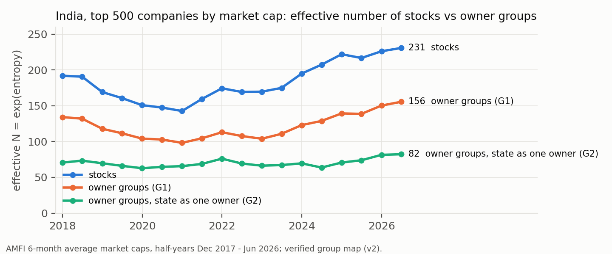
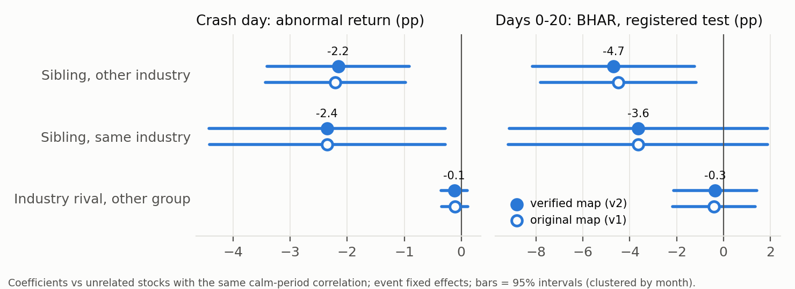

# Shared Owners, Shared Crashes? Business Groups, Crash Co-movement and Portfolio Risk in India

**Mrigay Pathak** · Indiana University Bloomington · Working paper draft, November 2026

*Earlier working title: "Count Groups, Not Stocks: Business-Group Contagion and Hidden
Concentration in India". It was changed because the registered portfolio test (Section 6)
did not support "count groups" as a portfolio rule.*

*Pre-registration: `docs/group_dependency/PREREGISTRATION.md` (pilot) and
`PREREGISTRATION_2.md` (portfolio test). Results: `results/group_dependency/`
and `results/group_concentration/`. Every headline number traces to a file listed in
Appendix C. This paper uses share prices and public filings only and makes no claim about
any firm's conduct.*

---

## Abstract

Investors count diversification in stocks; risk models measure it from past co-movement. In India, many listed firms share a controlling promoter group. We ask whether
shared owners add crash risk that pre-event correlation misses, and whether that matters
for portfolios.
- **Single stocks.** In a pre-registered study of 113 one-day crashes of group firms
  (2006–2025), siblings in unrelated industries lost 4.7 points more over the next month than equally correlated unrelated stocks (*t* = −2.66, as registered;
  wild-bootstrap *p* = 0.03 by group, not pre-registered). Industry rivals lost 0.35
  points. It sits in a few episodes, mostly in stressed groups, and much of it on the crash day, as group firms fall together.
- **The market.** By full market cap, India's top 500 companies have an effective number of
  231 stocks but 156 owner groups. Active funds show a much smaller gap (about 10%).
- **Portfolios.** A second pre-registered test finds no detectable effect. Portfolios
  holding 31 rather than 43 effective owner groups, matched on industries, diversification
  and volatility, lost 0.30 points more in six crises (placebo *p* = 0.125;
  the design could detect about 0.5–0.75 points).

Counting owner groups is not supported as a general diversification rule.

---

## 1. Introduction

A portfolio manager who holds 50 Indian stocks thinks she holds 50 bets. A risk model that
estimates a covariance matrix from the past year agrees, give or take the correlations it
sees. Neither asks who owns the companies. In India, a large share of listed market value
sits in business groups: families or holding companies that control several listed firms
across unrelated industries. If those firms fall together when one of them cracks, then
counting tickers overstates diversification. Correlation-based tools would also miss it,
because siblings in unrelated industries need not move together on ordinary days.

This is a practical problem for three kinds of decision-makers.
- **Investors and index providers** must decide how many independent exposures a
  portfolio or an index really contains.
- **Fund boards and regulators** must decide whether to report and limit exposure by
  issuer only, or also by promoter group.
- **Risk managers** must decide whether a covariance estimate from calm markets is enough
  to size a crash.

The question this paper answers is narrow: **after a business-group firm's own crash, do
its group siblings in other industries fall more than unrelated stocks with the same pre-event correlation, and more than the crashing firm's industry rivals?** How much does
counting owners instead of stocks change the measured diversification of the Indian market
and of real funds? And does concentrating a diversified portfolio in fewer owners deepen
its losses in a crisis?

**The answer, in four parts.**

1. **Owner-level crash co-movement beyond correlation exists for single stocks, but it is
   concentrated.** Siblings in unrelated industries lose 4.5–4.7 points more over the
   month than equally correlated unrelated stocks, and industry rivals lose almost nothing
   extra. The month-long effect passes the pre-registered test and a group-level wild
   bootstrap (*p* = 0.03). But:
      - much of it is several group firms falling together on the crash day;
   - ten events carry nearly all of it;
   - without the episodes a companion paper had already studied, almost nothing is left
     after the crash day;
   - Tata's siblings show nothing.
2. **The market is concentrated by owner.** By full market cap, the top 500 companies have
   an effective number of 231 stocks but 156 owner groups. That is fewer than random
   groupings of the same sizes would give (about 190).
3. **In the 25 active funds we could check, the gap is small.** The median fund holds only
   10% fewer effective owner groups than effective stocks.
4. **Moderate owner concentration does not measurably deepen a diversified portfolio's
   crisis losses.** We ran a second pre-registered test with matched portfolios across six
   Indian crises.
   - The concentrated portfolios (31 effective owner groups against 43) had the same
     group-affiliated weight, industries, effective number of bets and trailing
     volatility.
   - They lost 0.30 points more, on market falls of 9% to 76%.
   - They lost more in 4 of 6 windows, but the difference is not distinguishable from
     chance (placebo *p* = 0.125). The design could detect differences of about 0.5–0.75
     points.
   - Owner-group effective N does not help predict crisis drawdowns once volatility and the
     effective number of bets are known.

### Contribution

The pieces of this argument exist separately. What this paper adds:

- **An event-level test against industry rivals, controlling for each pair's pre-event
  correlation** (versus Kwon, Jung, Sunwoo and Yim 2019). Kwon et al. show that crash risk
  spreads among Korean chaebol members, using firm-year crash measures. We work at the
  event level in India and compare siblings in *other* industries with the crashing
  firm's *industry rivals*. We control directly for how correlated each pair already was,
  which tests whether a correlation-based risk model already sees the risk.
- **The crash-time price consequence of known group links.** This is set against Bertrand,
  Mehta and Mullainathan (2002); Gopalan, Nanda and Seru (2007); Khanna and Thomas (2009);
  and Faccio, Morck and Yavuz (2021).
  - Bertrand et al. show that resources move between Indian group firms (tunnelling).
  - Gopalan et al. show that intragroup loans support weak members, and that the first
    bankruptcy in a group is followed by lower financing, investment and profits at the
    other members.
  - Khanna and Thomas show that shared owners raise stock synchronicity on average days in
    Chile.
  - Faccio et al. show that group affiliates' idiosyncratic returns respond less to their
    own commodity shocks than similar standalone firms' returns do.

  We study what happens to siblings' prices when one member crashes, beyond pre-event
  co-movement and against industry rivals. Risk sharing inside groups (Khanna and Yafeh
  2005, who find it in Japanese, Korean and Thai groups but little elsewhere) could push
  either way: support for a failing member costs its siblings, but expected support can
  also calm the market.
- **An ownership-based diversification measure** (versus Meucci 2009, and Greenwood and
  Thesmar 2011). Meucci's effective number of bets is built from the covariance matrix, so
  it sees only what past prices show. Greenwood and Thesmar show that concentrated or
  correlated *investors* make prices fragile, and Antón and Polk (2014) that common
  institutional owners raise correlation. We build an effective number of *owner groups*
  from holdings and a filing-checked promoter map, with a random-grouping benchmark. We
  measure it for the Indian market and for 25 funds, and we test it with a pre-registered
  portfolio experiment. As far as we found, no paper builds diversification measures on
  promoter-group ownership. Our answer is mixed: the measure describes real concentration
  in the market, but it does not predict the crisis drawdowns of diversified portfolios.
  That is a negative result for "count groups" as a general risk rule.

What the paper does not add: that group firms are linked (Gopalan et al.), that they
co-move (Kim, Kim and Lee 2015), or that crash risk spreads inside groups (Kwon et al.).
The novelty is the combination: the event design against industry rivals, the correlation
control, two pre-registrations, the ownership-based measure, and a test of whether it
matters for portfolios.

---

## 2. Framework

**Effective N.** For portfolio weights *w* over *n* items, the entropy is
H = −Σ wᵢ ln wᵢ, and the effective number is N_eff = exp(H). A portfolio of 50 equal
weights has N_eff = 50. A portfolio dominated by a few names has N_eff far below its count.
We compute N_eff over three units:
- **stocks:** the usual reading;
- **owner groups:** weights summed within each promoter group;
- for comparison, **industries.**

The ratio N_eff(stocks) / N_eff(groups) says how much counting tickers overstates the
number of independent owners. A ratio of 1 means every stock has its own owner.

**Who counts as one owner?** Three definitions, fixed before any result:
- **G1 (primary):** Family and Corporate groups are groups. Everything else (multinational
  subsidiaries, state-owned firms, professionally managed and private-equity-controlled
  firms, unmatched names) is standalone.
- **G2:** G1, plus all state-owned firms as one owner (the Government of India).
- **G3:** G1, plus multinational subsidiaries grouped by parent.

**Why owners might matter beyond correlation.** Siblings can fall together after one
member's crash for three reasons.
- **Shared finance:** intragroup loans and guarantees, and shared lenders.
- **Shared promoter wealth:** pledged promoter shares can trigger forced sales across the
  group.
- **Shared information:** news about the promoter is news about every member.

On calm days, siblings in unrelated industries need not co-move much, so a covariance
matrix estimated in calm markets understates their joint crash risk. Prices cannot tell
these channels apart. The question here is only whether the shared owner predicts
siblings' losses beyond what pre-event correlation shows.

---

## 3. Data

**Prices.** We use a survivorship-free NSE panel: 1,620 symbols, January 2005 – June 2025,
with splits and bonuses corrected and delisted firms included. The universe is every
symbol that was in the top 500 by 63-day traded value at any month-end (1,609 symbols). It
was built from traded value alone, before any return was computed.

**The promoter-group map, v1.** Each symbol is labelled with its controlling promoter
group (with dates for changes of control), a group type and one of 41 industries. An AI
labeller built it from NSE's symbol lists, its own knowledge and some web searches, and
spot checks fixed 14 errors. It has 1,695 rows, and 110 Family/Corporate groups have two
or more listed companies (379 companies).

**The verified map, v2.** Because v1 rested on an AI's memory, it was checked against
filings before the paper:
- NSE shareholding-pattern filings (XBRL, 2020/21 onward; 11,106 filings) were parsed for
  750 priority symbols: every firm in a sibling event, every member of a multi-company
  group and every low-confidence row. Each firm was checked for a shared promoter entity
  with its group.
- The 135 firms in the sibling events were checked at their event dates against news,
  annual reports and group lists. Every flagged row was reviewed, and the decision was
  recorded with its source.
- **21 symbols (26 rows) changed.** For example, Great Offshore had been wrongly merged
  with Bharati Shipyard's group before Bharati took control. Some control dates and group
  assignments were corrected, and missed members were added.
- **Limits:** 230 symbols have no 2020+ filing and no confirming document, and 858, mostly
  standalone firms, were not checked. Low-confidence rows fell from 209 to 117.

Appendix B has the details. A name check found no duplicate group names; family branches
(Bajaj, Jindal, TVS, the two Ambani groups) are kept as separate owners.

**Market capitalisation.** AMFI publishes half-yearly average market caps for every listed
company: 18 half-years from December 2017 to June 2026, each with 4,792–5,427 companies.
The top 500 hold about 90% of total market cap. The map matches 93.2% to 98.5% of top-500 market cap,
depending on the half-year.

**Fund holdings.** The official monthly portfolio files of 7 asset managers, as of 31
October 2026: 25 equity funds across small-, mid-, large-, flexi- and multi-cap and value
categories. The equity holdings are mapped from ISIN to NSE symbol to group. HDFC, Kotak,
ICICI Prudential, Franklin and Quant could not be downloaded and are not covered.

---

## 4. How concentrated is the market by owner?

*Figure 1. Effective number of stocks and of owner groups (G1, G2) among India's top 500
companies by AMFI average market cap, December 2017 – June 2026, verified map.*

**Table 1. Effective N by stocks and by owner groups, top 500 and top 100**

| | Dec 2017 | Jun 2026 |
|---|---|---|
| Top 500: effective N of stocks | 191.9 | 230.7 |
| Top 500: effective N of owner groups (G1) | 134.1 | 155.6 |
| Top 500: owner groups, state as one owner (G2) | 70.7 | 82.3 |
| Top 500: stocks / groups (G1) | 1.43 | 1.48 |
| Top 100: stocks / G1 / G2 | 70.8 / 52.2 / 29.6 | 73.4 / 50.6 / 30.5 |

*Source: `results/group_concentration/v2/headline_by_period.csv`. G3 (multinationals by
parent) is within 1.5 of G1 in every period.*

**The market.** By full market capitalisation, India's 500 largest companies have an
effective number of 231 stocks but 156 owner groups. Treating the state as one owner gives
82. Any coarser grouping lowers effective N, so a benchmark matters. We report two, which
were not pre-registered (`results/paper2_referee/referee_checks.json`).
- Grouping the same 500 companies by **industry** gives 36 effective industries.
- **Randomly regrouping** them into groups of the same sizes as the real owner groups gives
  190 on average, with 90% of draws between 180 and 198.

Real owner groups (156) are more concentrated than every random regrouping: the large
companies sit together in a few groups. Counting only Family groups, and treating
Corporate groups such as HDFC, ICICI and L&T as standalone, gives 163.

The ratio of stocks to groups has stayed between 1.43 and 1.63 since 2017, peaking in
December 2022. The largest owner groups by share of top-500 market cap are Tata (5.4%),
Mukesh Ambani's Reliance (4.9%), Adani (3.7%), HDFC (3.7%), Bajaj (3.2%) and Bharti
(3.1%). A full-market-cap investor therefore holds about a third fewer owners than stocks.

Two caveats apply. Index funds weight by free-float market cap, which gives promoter-heavy
and state-owned firms less weight, so the figure for an index investor will differ; we have
not computed it. And the December 2025 and June 2026 values use map labels that end in June
2025, treated as still current.

**Funds: an honest negative.** We expected funds to show the same gap. They mostly do not.

**Table 2. Owner concentration in 25 equity funds, October 2026**

| | Median | Range |
|---|---|---|
| Effective N of stocks | 51.2 | 22.3 – 189.3 |
| Effective N of owner groups (G1) | 47.2 | 20.9 – 171.7 |
| Ratio stocks / groups (G1) | **1.10** | 1.00 – 1.24 |
| Equity weight matched to the map | 90.2% | |

*Source: `results/group_concentration/fund_level_latest_v2map.csv`; all 25 funds are in
Appendix D.*

The median fund holds only about 10% fewer effective owner groups than effective stocks.
- **Large-cap funds** have among the highest ratios (1.11–1.23); the single highest, 1.24,
  is DSP Flexi Cap. Their largest group exposures are financial groups with several listed
  companies, such as HDFC and ICICI.
  - Their ratios are below the cap-weighted top 100's 1.45, so their stock count
    overstates their owner count less than the index's does.
  - In absolute terms, though, they hold fewer effective owner groups (25–36) than the
    cap-weighted top 100 (50.6).
- **Small-cap funds** are close to 1 (1.00–1.10). But only 68–84% of their weight is
  matched to the map, and across the 25 funds the ratio rises with the matched weight
  (Spearman 0.66). Unmatched holdings count as standalone, so these ratios are biased
  toward 1.
- **The sample** is a convenience sample: the funds whose files we could download.

With those caveats, the typical active fund does not hide much owner concentration. The
concentration sits in the cap-weighted market and in specific large positions, such as the
HDFC group's 9.8% of the Parag Parikh Flexi Cap Fund. The "your fund owns 50 stocks but far
fewer families" story does not hold for the typical active fund, and the paper does not
make it.

---

## 5. The pre-registered crash test

### 5.1 Design

The rules (`PREREGISTRATION.md`) were committed before the event list was built, and the
event list before any comparison stock's return was computed. One run followed. The commit
sequence is in Appendix A.

- **Events (triggers).** A trigger is a firm of a Family/Corporate group that, on one day:
  - falls at least 15%;
  - falls at least 12 points more than the market and than its industry's non-group firms;
  - has at least one other group firm in the top-500 universe that day.

  Each group gets one event per 20-day episode, and windows run from 2006 to 2025.
- **Classes.** Every other top-500 stock that day is classed as:
  - **S:** a sibling in another industry (the key class);
  - **SI:** a sibling in the same industry;
  - **R:** an industry rival outside the group;
  - **B:** an unrelated stock (the baseline).
- **Outcome.** Each stock's buy-and-hold return over the 21 trading days from the crash
  day, minus the market's (BHAR 0–20).
- **Control.** Each stock's daily return correlation with the trigger over the pre-event
  year (trading days −261 to −10). If siblings fall only because they always move
  together, this control absorbs it.
- **Regression.** The outcome on S, SI and R dummies, the pre-event correlation, log size and
  log illiquidity, with one fixed effect per event and standard errors clustered by month.
- **Go / no-go rule (fixed in advance).** All three must hold:
  - β_S < 0 with *t* ≤ −1.96;
  - a permutation *p* < 0.05 (within each event, the sibling label is reshuffled among the
    sibling and unrelated stocks; 2,000 draws);
  - β_S ≤ β_R.

  Fewer than 30 sibling events, or fewer than 10 groups, means "too few to test".

**Two versions.** The registered run used the v1 map. Before any return was computed on
v2, a deviation (D1) re-ran the identical code once on the verified map. **v1 remains the registered result. v2 is reported alongside it** and is the version we
lead with, because its labels are checked against filings. The verification was done
after the v1 results, and the diagnostics naming the driving groups, were known. v2 is
therefore not blind, but its estimates are almost the same as v1's.

### 5.2 Sample

Under v2, 113 events come from 49 groups. 96 have at least one sibling pair (S or SI) that passes the data filters, and 72 have a
sibling in another industry (29 groups), which clears the "too few" bar. There are 39,345
stock pairs: 37,703 unrelated, 1,374 rivals, 227 siblings in other industries and 41
siblings in the same industry.

**Table 3. Raw averages by class (v2, before any control)**

| Class | Pre-event correlation with the trigger | Crash-day abnormal return | 21-day BHAR, mean / median |
|---|---|---|---|
| B: unrelated | −0.01 | +0.07% | −0.07% / −0.68% |
| R: industry rivals | 0.06 | −0.31% | −0.94% / −1.42% |
| **S: siblings, other industry** | **0.15** | **−2.63%** | **−5.47% / −3.20%** |
| SI: siblings, same industry | 0.28 | −3.51% | −5.77% / −0.60% |

*Source: `results/group_dependency/v2/tests.json` (`class_means`).*

Siblings normally move *more* closely with the trigger than rivals do (0.15 against 0.06).
That is why the correlation control matters.

### 5.3 Results

**Table 4. The registered test: BHAR 0–20, event fixed effects, clustered by month**

| | **v2: verified map (D1)** | v1: registered map |
|---|---|---|
| Events / with a sibling in another industry / groups | 113 / 72 / 29 | 115 / 74 / 30 |
| **β_S: sibling, other industry** | **−4.70 pp (*t* −2.66)** | −4.49 pp (*t* −2.64) |
| β_SI: sibling, same industry | −3.63 pp (*t* −1.29) | −3.65 pp (*t* −1.29) |
| β_R: industry rival | −0.35 pp (*t* −0.38) | −0.40 pp (*t* −0.44) |
| Pre-event correlation (per unit) | −7.05 pp (*t* −2.81) | −6.93 pp (*t* −2.78) |
| β_S − β_R | −4.35 pp (*t* −2.26) | −4.09 pp (*t* −2.17) |
| Within-event label permutation (2,000 draws) | 0 as negative; *p* < 0.0005 | 0 as negative; *p* < 0.0005 |
| β_S without the correlation control | −5.80 pp (*t* −3.10) | −5.55 pp (*t* −3.12) |
| **Go / no-go** | **GO** | **GO** |

*Source: `results/group_dependency/v2/tests.json` and `tests.json` (`primary`, `R10_no_rho`).*

*Figure 2. Extra loss of siblings in other industries, siblings in the same industry and
industry rivals, relative to unrelated stocks with the same pre-event correlation: crash day
(left) and days 0–20 (right). Filled: verified map; hollow: original map. Bars are 95%
intervals.*

By the rule fixed in advance, the verdict is **GO** in both versions. A firm in an
unrelated industry that shares an owner with the crashing firm loses about 4.7 points more
over the next month than an unrelated stock that normally moves just as closely with the
crashing firm. Industry rivals lose almost nothing extra. The same-industry sibling
coefficient rests on 41 pairs and supports no conclusion. The placebo distribution of β_S
from reshuffled sibling labels has a mean of 0.0, a standard deviation of 0.9 points and a
5th percentile of −1.4 points. The correlation control explains about 1 point of the
sibling effect, not most of it.

### 5.4 Robustness (registered list; none changes the verdict)

**Table 5. Registered robustness checks (β_S, BHAR 0–20 unless stated)**

| Check | v2 | v1 |
|---|---|---|
| R1: no 2008–09, no Feb–Apr 2020 | −5.01 pp (*t* −2.22) | −4.68 pp (*t* −2.13) |
| **R2: without the companion paper's episodes (7 events)** | **−1.85 pp (*t* −1.71)** | −1.87 pp (*t* −1.83) |
| R3: crash-day abnormal return | −2.16 pp (*t* −3.39) | −2.21 pp (*t* −3.51) |
| R3: CAR 0–20 | −5.51 pp (*t* −2.29) | −5.26 pp (*t* −2.25) |
| R5: clustered by trigger group | *t* −1.93 | *t* −1.97 |
| **R6: high-confidence labels only** | **−7.00 pp (*t* −2.53), 71 events** | −3.54 pp (*t* −1.67), 78 events |
| R7: news-checked, no artefacts | −10.33 pp (*t* −1.80), 24 events | −10.96 pp (*t* −2.01), 26 events |
| **R8: events weighted equally** | **mean −4.1, median −2.4 pp; 56% negative (sign *p* 0.205)** | −4.4 / −2.9 pp; 57% (0.148) |
| R3: BHAR plus the move implied by pre-event beta | −4.29 pp (*t* −2.68) | −4.10 pp (*t* −2.67) |
| R9: correlation as ten decile dummies | −5.14 pp (*t* −2.90) | −4.92 pp (*t* −2.90) |

*Source: `tests.json` (`robustness`), both versions. R4 (wider group definitions) is
mis-specified, because triggers come only from Family/Corporate groups. It is identical to
the primary result and uninformative; this is disclosed, not re-run. Clustering by event or
by date gives t of −2.64 and −2.63 (v2).*

Two findings matter.
- **Every registered check has the predicted sign, but in v2 three fall below the 1.96
  bar:**
  - dropping the companion paper's episodes (*t* −1.71);
  - news-checked events only (*t* −1.80, 24 events);
  - clustering by trigger group (*t* −1.93).

  In v1, high-confidence labels only also falls short (*t* −1.67). In the equal-weighted
  event test, only 56% of events are negative (sign *p* = 0.205).
- **The v2 gain in R6 is a change in the sample, not proof of better labels.** v2's
  documentation rule moved 79 sibling pairs out of the high-confidence set (mean BHAR
  +0.1%; 45 of them Tata pairs) and 32 into it (mean −9.4%). 61% of the v2 high-confidence
  sibling pairs come from events in 2019 or later, whose mean BHAR is −14.1%, against 0.0%
  before 2019. The verified map leaves the main estimate where it was (−4.5 to −4.7
  points). It does not show that better labels make the effect stronger. (Not
  pre-registered; `results/paper2_referee/referee_checks.json`.)

**Table 5b. Inference that allows for dependence within groups (not pre-registered)**

| Outcome, sample | β_S | *t* (month) | *t* (trigger group) | Wild bootstrap *p* |
|---|---|---|---|---|
| BHAR 0–20, all 96 events | −4.70 | −2.66 | −1.93 | **0.033** |
| Crash day, all | −2.16 | −3.39 | −1.90 | 0.085 |
| CAR 1–20 (after the crash day), all | −3.35 | −1.61 | −1.64 | 0.050 |
| BHAR 0–20, without the companion episodes (89 events) | −1.85 | −1.71 | −1.58 | 0.047 |
| Crash day, without the companion episodes | −1.31 | −2.40 | −1.62 | 0.105 |
| CAR 1–20, without the companion episodes | −0.46 | −0.39 | −0.49 | 0.638 |
| BHAR 0–20, one event per group and year (83 events) | −4.25 | −2.26 | −1.74 | 0.024 |

*Wild cluster bootstrap-t by trigger group (41 groups), restricted under β_S = 0,
Rademacher weights, 1,999 draws, two-sided. Source:
`results/paper2_referee/referee_checks.json`.*

**What this changes.** Allowing for dependence within groups reverses the earlier ranking
of which result is robust. The month-long effect survives the group-level bootstrap
(*p* = 0.033); the crash-day effect does not (*p* = 0.085).
- **Much of the crash-day effect is several group firms falling together.** In 10 events,
  21 sibling pairs (of either industry class) had day-0 abnormal returns of −12% or worse.
  On 4 February 2019, for example, Reliance Capital was the trigger, and Reliance
  Communications and Reliance Power had abnormal returns of about −33% the same day.
  Prices cannot tell whether such same-day falls reflect shared news or fast transmission,
  such as forced sales of pledged shares across the group. Either way, it is group-level
  crash co-movement.
- **The response after the crash day is weaker.** Siblings lose a further 3.4 points
  (*p* = 0.050). Without the companion paper's episodes, they lose almost nothing more
  (−0.5 points).

### 5.5 Tails (H3; registered, no verdict)

Across 195,900 stock pairs with at least 750 overlapping days, we count how often both
stocks are in their worst 5% of days on the same day. We then subtract what a normal model
predicts from their calm-day correlation, measured on days when the market return is
between its 10th and 90th percentiles.

**Table 6. Excess joint-crash frequency (share of days, v2)**

| Pair type | Pairs | Excess joint-crash frequency |
|---|---|---|
| Unrelated | 188,656 | 0.155% |
| Same industry, different group | 6,872 | 0.207% |
| **Same group, different industry** | **329** | **0.218%** (placebo-group *p* < 0.001) |
| Same group and same industry | 43 | 0.277% |

*Source: `results/group_dependency/v2/tests.json` (`tail_dependence`).*

The normal model under-predicts joint crashes for every pair type. Same-group pairs in
different industries crash together on 0.553% of days, against 0.402% for unrelated pairs.
Their excess (0.218%) is close to the same-industry excess (0.207%), and we did not test
that difference. In the tails, sharing an owner adds about as much joint-crash risk as
sharing an industry.

### 5.6 What drives the month-long effect (NOT pre-registered diagnostics)

These diagnostics were computed after the registered run and are labelled as such
(`results/group_dependency/v2/diagnostics_not_preregistered.json`).
- **No single group drives it.** Dropping any one of the 29 groups leaves β_S between −3.3
  points (without Adani, *t* −2.29) and −7.1 points (without Tata, *t* −2.95). Its month-clustered *t* is −1.96 or below in
  all 29 cases; these runs were not re-tested with clustering by trigger group.
- **A minority of events does.** The 10 worst of 72 events carry 99% of the *net*
  sibling loss, and the 5 worst carry 60%. It is net because some events go the other
  way: the five best have sibling residuals of +10% to +38%. Without the worst 5, the mean event
  residual is −1.8 points. The worst events are:
  - Adani Enterprises after the January 2023 short-seller report;
  - Future Consumer (February 2020);
  - Indiabulls firms in 2009 and 2019–20;
  - IndusInd Bank (March 2020);
  - Reliance Petroleum (November 2007);
  - Ujjivan (2021);
  - Reliance Capital (February 2019).
- **Groups differ sharply.** The average sibling residual is −20.8 points for Indiabulls
  (7 events), −16.9 for Adani (6), −6.1 for the Anil Ambani group (10) and −0.3 for Tata
  (6 events, 77 sibling pairs). It is +1.0 for Aditya Birla (3 events).
- **Crash day without the companion paper's episodes:** −1.3 points (*t* −2.40 clustered
  by month; sibling-minus-rival *t* −2.01). It is not significant with inference by trigger
  group (*t* −1.62; wild-bootstrap *p* = 0.105, Table 5b).

**Reading.** Sharing an owner predicts losses that pre-event correlation and industry
membership do not. But the evidence is concentrated:
- it comes from groups under visible financial or market stress at the time;
- it comes partly from group firms falling on the same day on shared news.

The stress label was judged after the fact. An ex-ante stress measure (promoter pledges,
or each group's drawdown over the prior six months) is the next test, and so is a
pre-event placebo window (days −60 to −21). Tata's siblings show nothing. Owner-level risk matters most when the group itself is
fragile.

---

## 6. The portfolio test (pre-registered)

*The design is the committed pre-registration (`PREREGISTRATION_2.md`, commit e571bc9,
before any portfolio outcome was computed). Results: `results/group_dependency/phase5/`.*

**Question.** Do portfolios concentrated in fewer business groups lose more in crises than
otherwise-identical portfolios?
- **H-P1 (primary):** they do, holding fixed:
  - the stock count and the industries;
  - the group-affiliated weight;
  - covariance-based diversification (Meucci's effective number of bets);
  - trailing volatility.
- **H-P2:** group-level effective N predicts crisis drawdowns beyond stock-level and
  industry-level effective N, the effective number of bets and trailing volatility.

**Windows.** Six crisis windows were fixed in advance, each running from the equal-weighted
market's high to its low:
- the global financial crisis (January 2008 – March 2009);
- the 2013 taper tantrum;
- the 2018 IL&FS episode;
- COVID (January – March 2020);
- the January–February 2023 Adani episode;
- the 2024–25 small-cap fall.

Portfolios are formed 126 trading days before each window starts, with equal weights, and
held. The outcome is the maximum drawdown inside the window.

**Matched triplets.** Each draw has three portfolios.
1. **B (base):** a random equal-weighted portfolio of 30 or 60 top-500 stocks.
2. **Swaps:** base stocks are swapped one at a time, each only when both of these exist:
   - a same-industry stock from a multi-company group that is **already in** the portfolio
     (for the concentrated twin, C);
   - a same-industry stock from a group in **neither** portfolio (for the dispersed twin,
     D).
3. **C and D** therefore replace the same base stocks with group-affiliated stocks, so
   their group-affiliated weight is identical. They differ only in how many groups that
   weight is spread over.
4. **A draw is kept only if:**
   - C and D each match B's effective number of bets within ±5%;
   - C and D each match B's trailing volatility within ±5%;
   - C's group effective N is at most 85% of B's.

**Tests and decision rule.**
- **T1:** the mean of DD(C) − DD(D) over all kept draws (500 per window and size).
- **Inference** uses placebo groups: group labels are reassigned across stocks at each
  formation date (200 reruns).
- **Support** requires a placebo *p* < 0.05 and a negative window-level T1 in at least 4
  of the 6 windows.
- **Registered secondaries:**
  - **T1b:** concentrated minus base.
  - **T1-x:** without the Adani window and the groups that drove the pilot (Adani, Anil
    Ambani, Indiabulls, Future). If T1 holds but T1-x fails, the verdict narrows to "group
    concentration matters when a group is under stress".
  - **T1-hc:** high-confidence labels only.
  - **T1 on window excess returns.**
- **T2 (H-P2):** a regression of drawdown on the five measures with window fixed effects,
  across 10,002 random portfolios per window. It needs a positive group coefficient, a
  placebo *p* < 0.05 and a leave-one-window-out R² gain.

**Design notes.**
- **Same affiliated weight, different groups.** The concentrated and dispersed twins hold
  the same group-affiliated weight, but different groups: the concentrated twin repeats
  groups already in the base portfolio, often large groups such as Tata or the Anil Ambani
  group. Results by group would help, but they are not registered. T1-x and the by-window
  results are the registered guards.
- **No power calculation** was registered.
- **No pledge moderator.** It was dropped, because the pledge data have no figures within
  100 days of any formation date.
- **Frozen.** The design was frozen in commit e571bc9.

### Results

The registered run (commit 6eea02f) kept 500 matched draws per window and portfolio size,
6,000 in all. On average:
- **Effective owner groups:** 31 in the concentrated twin, 43 in the dispersed twin and 41
  in the base.
- **Group-affiliated weight:** 0.38 in both twins.
- **Effective number of bets:** 1.17–1.18 in all three.

The outcome is the maximum drawdown inside each crisis window; negative means the
concentrated twin lost more.

**Table 7. The portfolio test: concentrated minus dispersed twin**

| | Drawdown difference | Placebo *p* | Windows with the concentrated twin worse |
|---|---|---|---|
| **T1, primary (all windows)** | **−0.30 pp** | **0.125** | **4 of 6** |
| T1b, concentrated minus base | −0.33 pp | 0.075 | |
| T1-x, without the Adani window and the pilot's groups | −0.41 pp | 0.125 | 3 of 5 |
| T1-hc, high-confidence labels only | −0.23 pp | 0.22 | 4 of 6 |
| Same comparison on window excess return | −0.34 pp | | |

**Table 8. T1 by crisis window**

| Window (equal-weighted market fall) | T1 |
|---|---|
| Global financial crisis 2008–09 (−76%) | −0.74 pp |
| Taper tantrum 2013 (−26%) | −0.02 pp |
| IL&FS 2018 (−21%) | +0.01 pp |
| COVID 2020 (−44%) | −1.13 pp |
| Adani episode 2023 (−9%) | +0.46 pp |
| Small-cap fall 2024–25 (−23%) | −0.39 pp |

*Source: `results/group_dependency/phase5/results.json` and `twin_pairs.parquet`.*

**What the numbers say.**
- **Pair level:** the concentrated twin lost more in 55% of draws, with a median
  difference of −0.16 points.
- **Placebo:** the T1 values from reshuffled group labels have a mean of 0.0 points, a
  standard deviation of 0.30 points and a 5th percentile of −0.42 points. So this design
  could detect only differences of roughly 0.5–0.75 points.
- **T2 (60,012 random portfolios):**
  - the coefficient on log group effective N is −0.0006, the wrong sign and essentially
    zero (placebo *p* = 0.35);
  - adding it *lowers* the out-of-sample R² (0.074 against 0.076);
  - trailing volatility is what predicts the drawdown.
- **Verdicts by the registered rules: H-P1 not supported. H-P2 not supported.**

The direction is the predicted one in the two biggest crashes. In 2008–09 and COVID, the
concentrated twin lost 0.7–1.1 points more. But that is about a point or less (0.74 and 1.13 points) on market falls of 44–76%, and
it is not distinguishable from chance by the rule fixed in advance. Removing
the stressed groups that drove the pilot (T1-x) does not change the picture, and neither
does keeping only the best-documented labels (T1-hc).

**Notes on the run.**
- In T1-hc, the taper window at 60 stocks found only 6 acceptable draws within the
  retry cap, as the rules allow.
- The run took about 2.5 hours, against 26 seconds timed for construction alone. No rule
  changed.
- The promoter-pledge moderator was skipped (no pledge figures near any formation date).
- The planned illustration with one fund's monthly holdings is deferred, because its
  public monthly files were not fetched.

## 7. Implications

The combined evidence points to a narrow reading: **owner-level crash risk shows up in a
few episodes, mostly in groups we judge (after the fact) to have been under stress. It
plausibly matters for large single-group positions, which we did not test. It is not
supported as a general diversification rule.**

**For investors and fund managers.** Siblings of a crashing group firm lose more than their past correlation suggests, mostly
when the group is under stress. That suggests, but our tests do not show, that a large
position in one group is riskier than its covariance estimate shows, especially around
group-specific news. Examples are a single group at nearly 10% of a fund, or several
companies of one stressed group. But a diversified portfolio that holds somewhat fewer
owners is not measurably riskier in a crisis. Counting effective owner groups is a useful
description, not a better risk measure than volatility and covariance-based
diversification.

**For index users and fund reporting.** Weighting India's top 500 by full market cap gives
about a third fewer effective owners than stocks (156 against 231). We did not compute the
free-float weights that Indian indices use, which give promoter-heavy and state-owned
firms less weight. Six groups each hold between 3.1% and 5.4% of top-500 market cap. Reporting
the largest promoter-group exposures alongside sector exposure needs only public filings,
and it flags the single-group positions where the risk sits. For most active funds the
summary ratio is unremarkable (about 1.1), which is itself useful information.

**For regulators and risk managers.** SEBI already uses a group lens. Since August 2023,
foreign portfolio investors with more than half of their Indian equity holdings in a single
corporate group must make additional look-through ownership disclosures, or cut the
exposure. Our evidence is consistent with a single-group focus of this kind. A stress
scenario that shocks all members of a group together is a sensible complement for large
group exposures. Our evidence does not support replacing covariance-based measures with
owner counts. This paper uses prices and public filings only. It makes no claim about why
any group's firms fell, or about any firm's conduct.

---

## 8. Limitations

- **Dependence and concentration.**
  - Events cluster in a few groups, and the same siblings recur across events.
  - With inference by trigger group, the crash-day effect is not significant, and the
    month-long effect is (*p* = 0.033).
  - Ten of 72 events carry the net effect.
    - Without the companion paper's episodes, the month-long effect shrinks to −1.85 points.
    It is below the registered bar with month clustering (*t* −1.71), but its wild-bootstrap
    *p* by trigger group is 0.047. Nothing remains after the crash day (−0.46 points,
    *p* = 0.64).
- **Shared news versus transmission.** When news concerns a whole group, all its firms fall
  because the news is about all of them. Much of the crash-day effect is of this kind. The
  test shows that owner-level crash risk exists and that pre-event correlation misses it.
  It does not show that one firm's crash causes the others' falls.
- **"Stressed groups" is a post-hoc reading.** No ex-ante stress measure was tested. The
  pledge data are too thin before 2020.
- **Parent–subsidiary and holding-company links are not separated.** Some sibling pairs are
  a holding company and its operating company, or a parent and a subsidiary: for example,
  Ujjivan Financial Services and Ujjivan Small Finance Bank, or Reliance Capital and
  Reliance Nippon AMC. That is a cash-flow link rather than a shared promoter.
- **The map.**
  - It was checked against filings for 750 priority symbols, but 230 symbols are
    unverifiable and 858 were not checked.
  - Most pre-2020 labels rest on group-company lists, and the event-date check was done by
    an AI subagent and reviewed by the author.
  - v2 was built after the v1 results were known.
  - Family-branch boundaries are judgement calls.
  - Industries were assigned by the same labeller; Adani Enterprises is labelled
    "Diversified & Holding Companies", which makes every Adani sibling an
    "other-industry" sibling.
- **R4 was mis-specified,** so nothing is learned about multinational, state or
  private-equity groups.
- **Controls.** Size, liquidity and pre-event correlation are controlled. Market beta
  enters only through the implied-move check (R3), and leverage not at all.
- **Event quality.** In a random news-checked sample of 28 events (v2):
  - 14 had firm- or group-specific bad news;
  - 2 were corporate-action artefacts;
  - 7 coincided with market- or industry-wide news;
  - 5 had no news found.
- **Day 0 is the crash day,** not the news day. Where the news came out earlier, earlier
  sibling losses are not counted. For example, the Adani short-seller report came out on
  24 January 2023, but the first −15% day was 27 January.
- **Universe.** Only top-500 stocks are seen.
- **Market concentration** uses full, not free-float, market cap, and labels past the map's
  June 2025 end.
- **Funds:** one month, a convenience sample of 25 funds from 7 managers, and partial map
  coverage that biases ratios toward 1.
- **The portfolio test.**
  - It could detect differences of only about 0.5–0.75 points.
  - The concentrated twins were only moderately concentrated (31 against 43 effective
    groups), and far more concentrated portfolios may behave differently.
  - The one owner-specific crisis window (Adani, 2023) was a mild market fall of 9%.
  - Six windows share their shocks within each window.
- **Not out of sample in time.** Both tests use 2006–2025. A clean check needs another
  market with business groups (Korea) or post-2025 data.

---

## 9. Conclusion

For a full-market-cap holder of India's top 500, counting stocks overstates the number of
effective owners by about half: 231 stocks against 156 owner groups. In the 25 active
funds we checked, the overstatement is about 10%.

For single stocks, a shared owner is a channel that pre-event correlation misses. Siblings
in unrelated industries lose about 4.7 points more over the month after a group firm
crashes, while industry rivals lose no significant extra amount (−0.35 points,
*t* −0.38). But the evidence is concentrated:
- much of it is group firms falling together on the crash day;
- ten events carry it;
- without the best-known episodes, little remains after the crash day.

For portfolios, the registered test found no detectable effect. Matched portfolios with
about a quarter fewer effective owners lost only 0.3 points more in six crises, which is
not distinguishable from chance. Owner-group effective N added nothing beyond volatility
and covariance-based diversification.

The honest summary is that shared owners went with shared crashes for single stocks, in a
few, mostly stressed, groups. Moderately fewer owner groups (31 against 43) did not
detectably deepen diversified portfolios' crisis losses. But the test cannot rule out
differences below about 0.5–0.75 points, or effects at higher concentration. A clean
out-of-sample test needs another market with business groups (Korea) or data after 2025.

---

## Appendix A. Pre-registration and commit record

| Commit | What it fixed |
|---|---|
| 3e6155f | Literature check and universe (traded value only) |
| 5d74939 | The group map (v1) |
| 133c5c9 | Rules and go/no-go test (pre-registration Part 1) |
| be33f0c | Event list and news labels, before any comparison stock's return (Part 2) |
| 8b08f04 | The single registered run, plus diagnostics labelled as not pre-registered |
| D1 (12 Nov 2026) | Verified map v2 committed before any return was computed on it; identical re-run |
| e571bc9 | Portfolio-test pre-registration and code, before any portfolio outcome |
| 6eea02f | The single registered portfolio-test run |

Rules: `docs/group_dependency/PREREGISTRATION.md` (§1 hypotheses, §6 primary test, §8
robustness, §10 deviation D1). Portfolio test: `PREREGISTRATION_2.md` (committed before any portfolio outcome).

## Appendix B. Map verification (v1 → v2)

- **Checked:** 750 priority symbols against NSE shareholding-pattern XBRL filings (2020/21
  onward). The 135 sibling-event firms were checked at their event dates against news,
  annual reports and group lists. There were 95 reviewed decisions.
- **Changed (21 symbols, 26 rows), for example:**
  - Great Offshore separated from Bharati Shipyard before 2009–10.
  - Corrected control dates: Avaya GlobalConnect left Tata in 2004; UB kept Mangalore
    Chemicals to end-2014; the Indiabulls promoter was declassified at Sammaan Capital in
    2023; Orient Cement, Reliance Naval and Religare changed control in 2024–25.
  - Corrected groups: Maharashtra Seamless and Jindal Drilling are DP Jindal; Mangalam
    Cement is BK Birla.
  - Missed members added: Yaari Digital (Indiabulls), Sonata Software (Rajan Raheja).
- **Confidence:** high-confidence rows rose from 1,017 to 1,149, and low-confidence rows
  fell from 209 to 117.
- **Not verified:** 230 symbols have no filing or confirming document, and 858 were not
  checked.
- **Files:** `results/group_dependency/group_map_v2.csv`, `group_map_v2_changes.csv`,
  `verify/`.

## Appendix C. Traceability

Run `~/.venvs/strategyhub/bin/python scripts/group_dependency_paper_check.py` to recompute
every number below from its file and check that it appears in the text.

| Headline number | Value | Source |
|---|---|---|
| Top 500 effN stocks, Dec 2017 / Jun 2026 | 191.9 / 230.7 | `results/group_concentration/v2/headline_by_period.csv` |
| Top 500 effN groups G1 | 134.1 / 155.6 | `results/group_concentration/v2/headline_by_period.csv` |
| Top 500 effN groups G2 | 70.7 / 82.3 | `results/group_concentration/v2/headline_by_period.csv` |
| Top 500 ratio stocks/G1 | 1.43 / 1.48 | `results/group_concentration/v2/headline_by_period.csv` |
| Top 500 ratio, min and max over periods | 1.43 / 1.63 | `results/group_concentration/v2/headline_by_period.csv` |
| Top 500 matched market-cap share, min / max | 93.2% / 98.5% | `results/group_concentration/v2/headline_by_period.csv` |
| Top 100 stocks / G1 / G2, Jun 2026 | 73.4 / 50.6 / 30.5 | `results/group_concentration/v2/headline_by_period.csv` |
| Headline rounded: 231 / 156 / 82 | 231 / 156 / 82 | `results/group_concentration/v2/headline_by_period.csv` |
| Group shares of top-500 cap: Tata / Reliance / Adani | 5.4% / 4.9% / 3.7% | `results/group_concentration/v2/top_groups_latest.csv` |
| Funds: count / median ratio | 25 funds / 1.10 | `results/group_concentration/fund_level_latest_v2map.csv` |
| Funds: median effN stocks / G1 | 51.2 / 47.2 | `results/group_concentration/fund_level_latest_v2map.csv` |
| Funds: ratio range | 1.00 / 1.24 | `results/group_concentration/fund_level_latest_v2map.csv` |
| Funds: median matched weight | 90.2% | `results/group_concentration/fund_level_latest_v2map.csv` |
| v2 events / groups | 113 / 49 | `results/group_dependency/v2/events_summary.json` |
| v2 events with S / groups with S | 72 / 29 | `results/group_dependency/v2/tests.json` |
| v2 pairs | 39,345 | `results/group_dependency/v2/tests.json` |
| v2 class means S: rho / day-0 AR / BHAR mean / median | 0.15 / −2.63% / −5.47% / −3.20% | `results/group_dependency/v2/tests.json` |
| v2 beta_S / t | −4.70 pp / −2.66 | `results/group_dependency/v2/tests.json` |
| v2 beta_R / t | −0.35 pp / −0.38 | `results/group_dependency/v2/tests.json` |
| v2 beta_SI / t | −3.63 pp / −1.29 | `results/group_dependency/v2/tests.json` |
| v2 beta_S - beta_R / t | −4.35 pp / −2.26 | `results/group_dependency/v2/tests.json` |
| v2 beta_S without rho / t | −5.80 pp / −3.10 | `results/group_dependency/v2/tests.json` |
| v2 permutation draws as negative | 0 as negative | `results/group_dependency/v2/tests.json` |
| v2 R1_no_crises: beta_S / t | −5.01 pp / −2.22 | `results/group_dependency/v2/tests.json` |
| v2 R2_no_paper1_episodes: beta_S / t | −1.85 pp / −1.71 | `results/group_dependency/v2/tests.json` |
| v2 R3_day0_AR: beta_S / t | −2.16 pp / −3.39 | `results/group_dependency/v2/tests.json` |
| v2 R3_car_0_20: beta_S / t | −5.51 pp / −2.29 | `results/group_dependency/v2/tests.json` |
| v2 R6_high_confidence: beta_S / t | −7.00 pp / −2.53 | `results/group_dependency/v2/tests.json` |
| v2 R7_news_checked_clean: beta_S / t | −10.33 pp / −1.80 | `results/group_dependency/v2/tests.json` |
| v2 R9_rho_deciles: beta_S / t | −5.14 pp / −2.90 | `results/group_dependency/v2/tests.json` |
| v2 R8: share negative / sign p | 56% / 0.205 | `results/group_dependency/v2/tests.json` |
| v2 R5: t clustered by trigger group | −1.93 | `results/group_dependency/v2/tests.json` |
| v1 beta_S / t | −4.49 pp / −2.64 | `results/group_dependency/tests.json` |
| v1 beta_R / t | −0.40 pp / −0.44 | `results/group_dependency/tests.json` |
| v1 beta_SI / t | −3.65 pp / −1.29 | `results/group_dependency/tests.json` |
| v1 beta_S - beta_R / t | −4.09 pp / −2.17 | `results/group_dependency/tests.json` |
| v1 beta_S without rho / t | −5.55 pp / −3.12 | `results/group_dependency/tests.json` |
| v1 permutation draws as negative | 0 as negative | `results/group_dependency/tests.json` |
| v1 R1_no_crises: beta_S / t | −4.68 pp / −2.13 | `results/group_dependency/tests.json` |
| v1 R2_no_paper1_episodes: beta_S / t | −1.87 pp / −1.83 | `results/group_dependency/tests.json` |
| v1 R3_day0_AR: beta_S / t | −2.21 pp / −3.51 | `results/group_dependency/tests.json` |
| v1 R3_car_0_20: beta_S / t | −5.26 pp / −2.25 | `results/group_dependency/tests.json` |
| v1 R6_high_confidence: beta_S / t | −3.54 pp / −1.67 | `results/group_dependency/tests.json` |
| v1 R7_news_checked_clean: beta_S / t | −10.96 pp / −2.01 | `results/group_dependency/tests.json` |
| v1 R9_rho_deciles: beta_S / t | −4.92 pp / −2.90 | `results/group_dependency/tests.json` |
| v1 R8: share negative / sign p | 57% / 0.148 | `results/group_dependency/tests.json` |
| v1 R5: t clustered by trigger group | −1.97 | `results/group_dependency/tests.json` |
| Tail pairs (v2) | 195,900 | `results/group_dependency/v2/tests.json` |
| Tail excess: unrelated / same industry / same group / both | 0.155% / 0.207% / 0.218% / 0.277% | `results/group_dependency/v2/tests.json` |
| Leave-one-group-out: without Adani / without Tata | −3.3 / −7.1 | `results/group_dependency/v2/diagnostics_not_preregistered.json` |
| Worst 10 / worst 5 share of total sibling loss | 99% / 60% | `results/group_dependency/v2/diagnostics_not_preregistered.json` |
| Mean without worst 5 | −1.8 | `results/group_dependency/v2/diagnostics_not_preregistered.json` |
| Crash day without companion episodes: beta_S / t | −1.3 / −2.40 | `results/group_dependency/v2/diagnostics_not_preregistered.json` |
| Table 5b BHAR 0-20, all: beta / t month / t group / boot p | −4.70 / −2.66 / −1.93 / 0.033 | `results/paper2_referee/referee_checks.json` |
| Table 5b crash day, all: beta / t month / t group / boot p | −2.16 / −3.39 / −1.90 / 0.085 | `results/paper2_referee/referee_checks.json` |
| Table 5b CAR 1-20, all: beta / t month / t group / boot p | −3.35 / −1.61 / −1.64 / 0.050 | `results/paper2_referee/referee_checks.json` |
| Table 5b BHAR, no companion episodes: beta / t month / t group / boot p | −1.85 / −1.71 / −1.58 / 0.047 | `results/paper2_referee/referee_checks.json` |
| Table 5b crash day, no companion episodes: beta / t month / t group / boot p | −1.31 / −2.40 / −1.62 / 0.105 | `results/paper2_referee/referee_checks.json` |
| Table 5b CAR 1-20, no companion episodes: beta / t month / t group / boot p | −0.46 / −0.39 / −0.49 / 0.638 | `results/paper2_referee/referee_checks.json` |
| Table 5b BHAR, one event per group-year: beta / t month / t group / boot p | −4.25 / −2.26 / −1.74 / 0.024 | `results/paper2_referee/referee_checks.json` |
| Co-crashing siblings: pairs / events | 21 sibling pairs / In 10 events | `results/paper2_referee/referee_checks.json` |
| R6 shift: out / in / Tata out | moved 79 / 32 into / 45 of them Tata | `results/paper2_referee/referee_checks.json` |
| R6 shift: mean BHAR out / in | +0.1% / −9.4% | `results/paper2_referee/referee_checks.json` |
| R6 shift: share 2019+ / mean 2019+ / mean before | 61% / −14.1% / 0.0% | `results/paper2_referee/referee_checks.json` |
| Market: industries / family-only / random null mean | 36 effective industries / 163 / 190 on average | `results/paper2_referee/referee_checks.json` |
| Random null 90% range | between 180 and 198 | `results/paper2_referee/referee_checks.json` |
| Funds: Spearman ratio vs matched weight | Spearman 0.66 | `results/paper2_referee/referee_checks.json` |
| Funds: small-cap matched weight range | 68–84% | `results/paper2_referee/referee_checks.json` |
| Funds: large-cap ratio range vs top-100 ratio | 1.11–1.23 / 1.45 | `results/paper2_referee/referee_checks.json` |
| v2 R3 BHAR plus implied: beta / t | −4.29 pp / −2.68 | `results/group_dependency/v2/tests.json` |
| v1 R3 BHAR plus implied: beta / t | −4.10 pp / −2.67 | `results/group_dependency/tests.json` |
| Phase 5 draws | 6,000 in all | `results/group_dependency/phase5/results.json` |
| T1 / placebo p / windows | −0.30 pp / 0.125 / 4 of 6 | `results/group_dependency/phase5/results.json` |
| T1b / p | −0.33 pp / 0.075 | `results/group_dependency/phase5/results.json` |
| T1-x / p / windows | −0.41 pp / 0.125 / 3 of 5 | `results/group_dependency/phase5/results.json` |
| T1-hc / p | −0.23 pp / 0.22 | `results/group_dependency/phase5/results.json` |
| T1 on excess return | −0.34 pp | `results/group_dependency/phase5/results.json` |
| T1 by window | −0.74 pp / −0.02 pp / +0.01 pp / −1.13 pp / +0.46 pp / −0.39 pp | `results/group_dependency/phase5/results.json` |
| Window market falls | −76% / −26% / −21% / −44% / −9% / −23% | `results/group_dependency/phase5/results.json` |
| Placebo T1 sd / 5th pct | 0.30 points / −0.42 points | `results/group_dependency/phase5/results.json` |
| T2 portfolios / group coef / placebo p | 60,012 / −0.0006 / 0.35 | `results/group_dependency/phase5/results.json` |
| T2 OOS R2 with / without | 0.074 / 0.076 | `results/group_dependency/phase5/results.json` |
| Verdicts | H-P1 not supported / H-P2 not supported | `results/group_dependency/phase5/results.json` |
| Twins: effective groups C / D / B | 31 effective owner groups / 43 / 41 | `results/group_dependency/phase5/twin_pairs.parquet` |
| Twins: affiliated weight / ENB | 0.38 / 1.17–1.18 | `results/group_dependency/phase5/twin_pairs.parquet` |
| Twins: share C worse / median | 55% of draws / −0.16 points | `results/group_dependency/phase5/twin_pairs.parquet` |
| Run time | about 2.5 hours | `results/group_dependency/phase5/results.json` |

## Appendix D. The 25 funds (October 2026, verified map)

| Fund | Category | Holdings | effN stocks | effN groups (G1) | Ratio | Matched weight |
|---|---|---|---|---|---|---|
| Axis Flexi Cap Fund | Flexi cap | 69 | 46.3 | 42.1 | 1.10 | 93% |
| DSP Flexi Cap Fund | Flexi cap | 67 | 42.0 | 34.0 | 1.24 | 96% |
| Parag Parikh Flexi Cap Fund | Flexi cap | 51 | 22.3 | 20.9 | 1.07 | 100% |
| SBI Flexicap Fund | Flexi cap | 61 | 46.6 | 44.6 | 1.04 | 85% |
| Tata Flexi Cap Fund | Flexi cap | 66 | 51.2 | 42.4 | 1.21 | 91% |
| Axis Large Cap Fund | Large cap | 48 | 32.1 | 26.9 | 1.19 | 99% |
| DSP Large Cap Fund | Large cap | 42 | 28.0 | 25.2 | 1.11 | 99% |
| Nippon India Large Cap Fund | Large cap | 68 | 44.6 | 36.2 | 1.23 | 97% |
| SBI Large Cap Fund (formerly Bluechip) | Large cap | 54 | 35.0 | 29.3 | 1.19 | 94% |
| Tata Large Cap Fund | Large cap | 45 | 36.2 | 30.2 | 1.20 | 93% |
| Axis Midcap Fund | Mid cap | 85 | 66.5 | 61.2 | 1.09 | 86% |
| DSP Mid Cap Fund | Mid cap | 63 | 54.1 | 47.8 | 1.13 | 94% |
| Nippon India Growth Mid Cap Fund | Mid cap | 100 | 79.9 | 67.8 | 1.18 | 94% |
| SBI Midcap Fund | Mid cap | 56 | 50.1 | 46.7 | 1.07 | 90% |
| Tata Mid Cap Fund | Mid cap | 57 | 51.4 | 47.5 | 1.08 | 92% |
| Canara Robeco Multi Cap Fund | Multi cap | 111 | 91.1 | 81.4 | 1.12 | 88% |
| Nippon India Multi Cap Fund | Multi cap | 123 | 85.7 | 75.8 | 1.13 | 88% |
| Axis Small Cap Fund | Small cap | 129 | 105.6 | 102.2 | 1.03 | 84% |
| Canara Robeco Small Cap Fund | Small cap | 98 | 83.5 | 80.1 | 1.04 | 82% |
| DSP Small Cap Fund | Small cap | 85 | 66.9 | 66.9 | 1.00 | 68% |
| Nippon India Small Cap Fund | Small cap | 259 | 189.3 | 171.7 | 1.10 | 80% |
| SBI Small Cap Fund | Small cap | 63 | 51.2 | 48.5 | 1.06 | 71% |
| Tata Small Cap Fund | Small cap | 62 | 48.2 | 47.2 | 1.02 | 75% |
| Canara Robeco Value Fund | Value | 57 | 44.9 | 43.1 | 1.04 | 90% |
| Nippon India Value Fund | Value | 88 | 57.8 | 51.5 | 1.12 | 90% |

*Source: `results/group_concentration/fund_level_latest_v2map.csv` (portfolios as on 31 Oct 2026).*

---

## References

- Antón, M. and C. Polk (2014). Connected stocks. *Journal of Finance* 69(3), 1099–1127.
- Bertrand, M., P. Mehta and S. Mullainathan (2002). Ferreting out tunneling: An
  application to Indian business groups. *Quarterly Journal of Economics* 117(1), 121–148.

- Faccio, M., R. Morck and M. D. Yavuz (2021). Business groups and the incorporation of
  firm-specific shocks into stock prices. *Journal of Financial Economics* 139(3), 852–871.
- Gopalan, R., V. Nanda and A. Seru (2007). Affiliated firms and financial support:
  Evidence from Indian business groups. *Journal of Financial Economics* 86(3), 759–795.
- Greenwood, R. and D. Thesmar (2011). Stock price fragility. *Journal of Financial
  Economics* 102(3), 471–490.
- Khanna, T. and C. Thomas (2009). Synchronicity and firm interlocks in an emerging market.
  *Journal of Financial Economics* 92(2), 182–204.
- Khanna, T. and Y. Yafeh (2005). Business groups and risk sharing around the world.
  *Journal of Business* 78(1), 301–340.
- Kim, Kim and Lee (2015). Stock return commonality within business groups:
  Fundamentals or sentiment? *Pacific-Basin Finance Journal* 35A, 198–224.
- Kwon, Jung, Sunwoo and Yim (2019). Does stock price crash of firms in the
  same business group cause stock price crash in other member firms? Evidence from Korea.
  *Emerging Markets Finance and Trade* 55(7), 1566–1592.
- Meucci, A. (2009). Managing diversification. *Risk*.
- Pathak, M. (2026). Market share is not importance: What happens to rivals when a firm
  dies (US and India). Working paper, Indiana University.
